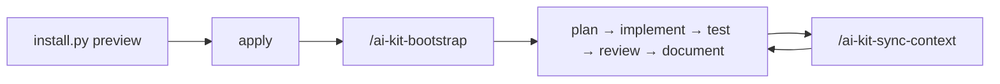

# AI-KIT

**Stop re-explaining your project to every new AI chat.**

AI-KIT gives your coding agents persistent project memory, expert stack rules, **Kubernetes-ready** containers, **adaptive model routing**, and native configuration for **11 AI clients**. Add **Cloudflare security-audit** for structured security review and **Strix** for scoped pentesting workflows. One offline installer, zero installer dependencies, changes previewed before you apply them.

[Features](#features-at-a-glance) · [Security workflows](#security-workflows) · [Quick start](#install) · [Stacks](#-built-for-your-stack) · [Presets](#presets) · [Update](#update-an-application-project)

## Features at a glance

| | Feature | What it does for you |
| --- | --- | --- |
| 🧠 | **Project memory** | Verified facts, module map, commands, and decisions that every new chat reads first |
| 🧩 | **Stack profiles** | Expert rules for Go, PHP, Laravel, Filament 5, Moodle, Python, Rust, .NET, Java, Terraform/Helm, frontend, and libraries, auto-detected per module |
| 🐳 | **Kubernetes-ready containers** | Every new Dockerfile and service ships with probes, graceful shutdown, non-root security, and manifests |
| 🧭 | **Adaptive model routing** | A 0-6 capability ladder that picks the right model role and reasoning effort for each task |
| 🤖 | **11 AI clients** | Codex, Claude Code, Cursor, Copilot, Gemini CLI, Windsurf, Cline, Roo, Aider, Kimi, Manus — with documentation evidence and lifecycle reporting |
| 🎯 | **Native client configuration** | Your real test commands run without prompts; module rules load only where they apply |
| 🛡️ | **Guardrails** | No commits without your request, confirmation before destructive commands, secret files off-limits |
| 🔐 | **Optional security workflows** | Cloudflare's audit method and nine Strix skills, pinned and invoked explicitly in Codex or Claude Code |
| 🔁 | **Engineering loop** | Plan → implement → test → review → document, with honest reporting of what was really checked |
| ⚡ | **One-command workflows** | `/ai-kit-bootstrap`, `/ai-kit-review`, `/ai-kit-sync-context` |
| 📦 | **Safe installer and upgrades** | Preview first, offline, backups, conflict candidates, explicit unchanged-adapter retirement, your local edits preserved |

## Why AI-KIT

AI-KIT preserves facts and decisions, points agents at real checks and records authorization boundaries:

- **Project knowledge:** manifests draft module facts and commands; bootstrap verifies them.
- **Stack depth:** relevant profiles cover framework authorization, transactions, cancellation, privacy and infrastructure review.
- **Your authority:** explicit commits/pushes, optional risky-command guards and secret exclusions.
- **Visible evidence:** unavailable checks remain unverified.

## Feature tour

### 🧠 Project memory that survives every chat

- **Verified context:** PROJECT_CONTEXT and project.json hold contracts, module facts, commands and unknowns.
- **Manifest drafts:** Go, Composer, Node, Python and Moodle evidence suggests versions and module commands until bootstrap confirms them.
- **Session start:** an optional Claude hook reads context and Git status.
- **Continuity:** decisions, ADRs and changelog preserve reasons; the continuity skill keeps context and pointers synchronized.

### 🧩 Built for your stack

| Profile | What the agent gets right |
| --- | --- |
| [Go](template/ai-kit/stacks/GO.md) | Context propagation, timeouts, error wrapping, goroutine ownership, `-race`, govulncheck, deliberate vendoring |
| [PHP](template/ai-kit/stacks/PHP.md) | Composer and PSR boundaries, exact money, bounded HTTP, narrow exceptions, `composer audit` |
| [Laravel](template/ai-kit/stacks/LARAVEL.md) | Policies, bounded transactions, after-commit jobs, idempotent effects, N+1 checks, safe migrations |
| [Filament 5](template/ai-kit/stacks/FILAMENT.md) | Resources, schemas, tables, and actions with server-side authorization, tenant scope, and bounded queries |
| [Moodle](template/ai-kit/stacks/MOODLE.md) | Plugin APIs, capabilities and `sesskey`, upgrade savepoints, Privacy API, cache invalidation |
| [Python](template/ai-kit/stacks/PYTHON.md) | Safe CLIs, pathlib, subprocess without a shell, isolated environments, uv/ruff for new packages |
| [Frontend](template/ai-kit/stacks/FRONTEND.md) | Pinned package manager, type/lint/build checks, accessibility, public-config hygiene |
| [Library/SDK](template/ai-kit/stacks/LIBRARY.md) | Public API stability, semantic versioning, consumer examples, compatibility matrices |
| [Rust](template/ai-kit/stacks/RUST.md) | Ownership and borrowing, unsafe discipline, Result errors, cargo fmt/clippy/test, lockfile hygiene |
| [.NET](template/ai-kit/stacks/DOTNET.md) | Nullable types, async with CancellationToken, deterministic disposal, dotnet build/test |
| [Java](template/ai-kit/stacks/JAVA.md) | Maven/Gradle wrappers, exception boundaries, try-with-resources, wrapper test/verify |
| [Terraform/Helm](template/ai-kit/stacks/INFRA.md) | Remote state, plan review, pinned providers and charts, fmt/validate and lint/template gates |

Profiles combine per module, so a monorepo with a Laravel app in `web/` and a Go service in `api/` gets the right rules in each place. Opinionated **owner conventions** for Laravel (no database foreign keys, public UUID beside the internal id, Policy + Factory + Seeder per model, one table per migration, Filament 5+ for new panels) are available; use `--conventions standard` to follow your project's own conventions instead.

### 🐳 Docker-aware, Kubernetes-ready by default

New containers follow the [Kubernetes-ready contract](template/ai-kit/CONTAINERS.md), including local Docker Compose projects:

- **Images/runtime:** pinned multi-stage images, build secrets outside layers, non-root execution, read-only root, exec entrypoints; no privileged mode or Docker socket.
- **Lifecycle:** startup/readiness/liveness probes, SIGTERM drain, migrations in separate Jobs.
- **Deployment:** ConfigMap/Secret, stdout logs, stateless replicas, PVCs where needed, dropped capabilities, seccomp and resource requests.
- **Preflight/cleanup:** verify Docker client and daemon. Cleanup needs verified disposable ownership and the 10 GB threshold; `scripts/docker_test_usage.py` collects evidence.

### 🧭 Adaptive model routing

Pay for intelligence only where it matters. The [routing policy](template/ai-kit/router/POLICY.md) maps every task to a capability level:

| Level | Task | Role / effort |
| --- | --- | --- |
| 0-1 | Classification, narrow mechanical edits | cheap / none or low |
| 2 | Substantive engineering | work / medium |
| 3-5 | Hard debugging, concurrency, distributed or sensitive correctness | work / high to max |
| 6 | Diagnosed capability shortfall | escalation |

Provider configurations map roles to OpenAI, Anthropic, Kimi, and Gemini models, or your own local/Ollama models. The offline helper understands English and Russian task descriptions and explains its choice:

~~~sh
python scripts/router.py route "debug a race condition in the queue worker"
~~~

`router.py configure` writes the resolved role mapping and a native Aider model file; `router.py providers` lists each provider's tier, status, and sources. The kit never fakes a model switch: when a client offers no switching control, you get a recommendation.

### 🤖 Works with your AI clients

| Client | What gets installed |
| --- | --- |
| Codex | `AGENTS.md` and `.agents/skills/` |
| Claude Code | `CLAUDE.md` importing AGENTS, skills, settings, path-scoped `.claude/rules/` |
| Cursor | `.cursor/rules/` with module globs, `.cursorignore` secrets |
| GitHub Copilot | `copilot-instructions.md` and per-module `.instructions.md` |
| Gemini CLI | `GEMINI.md` and `.geminiignore`; reads the shared skills |
| Windsurf, Cline, Roo | Native rule folders, with glob- or path-scoped module rules for Windsurf and Cline |
| Aider | `CONVENTIONS.md` and `.aiderignore`, plus model routing config |
| Kimi, Manus | Short entry files |

Scoped rules, ignore files, and settings come with the native-settings and scoped-rules extras. The preview spots the clients you already use from existing files and suggests the matching `--agent` list.

### 🎯 Native configuration from your project facts

- **Recorded checks:** Claude allow rules cover test/lint/build commands.
- **Secret exclusions:** shared lists cover env files, keys, Composer auth, Laravel/Moodle credentials and .pypirc through selected client deny/ignore controls.
- **Module scope:** native rules select relevant guidance by file path.
- **Owned entries:** Claude settings merge by key, using local settings in private mode and moving only kit entries on mode switches.

### 🛡️ Guardrails you can trust

- **No surprise commits.** Commits and pushes require your explicit request, and optional Claude Code ask rules back that up.
- **Confirmation before damage.** With data guards, Claude Code asks before `rm -rf`, `git reset --hard`, `git clean`, a Docker prune, or a Laravel/Moodle migration.
- **Security baseline:** input validation, server-side authorization, and no secrets in code, logs, or prompts. Dependency audits run per stack with `composer audit`, `govulncheck`, `pip-audit`, and your package manager's audit.
- **Honest verification:** unavailable tools, services, or CI are reported as unverified, never as passed.

### 🔁 Engineering loop and one-command workflows

Every task follows **plan → implement → test → review → document**, with staged migrations and rollback plans, review by concrete scenario and severity, and a changelog entry for every change. Owner conventions add a Codecov gate of at least 90% of changed lines when Codecov is configured. Three user-invoked skills make the routine instant:

- `/ai-kit-bootstrap` confirms installer drafts and fills context from real evidence.
- `/ai-kit-review` reviews current changes against the engineering and security rules.
- `/ai-kit-sync-context` updates context, decisions, and the changelog after work.

In Codex, use `$ai-kit-bootstrap` and the other skills the same way.

### Security workflows

**v1.1.0 brings established security methods into your coding workflow.** Give your agent a structured audit method for understanding risk, and a separate workflow for testing exploitability with Strix. Choose the capability your task needs; enable either or both.

| Integration | What it adds | Install flag | Codex / Claude Code |
| --- | --- | --- | --- |
| **Cloudflare security-audit** | Security guidance and focused review; a full audit method with reconnaissance, hunting, evidence validation, coverage and reporting | `--with-security-audit` | `$security-audit` / `/security-audit` |
| **Strix** | Workflows for code, web application, API and OWASP testing, findings review and requested remediation; separate CI/cloud references | `--with-strix` | `$strix` / `/strix` |

**Cloudflare: a method for evidence-based review.** The complete upstream skill includes attack-class references, report schemas and Node.js validators. The short entry point loads only relevant material and distinguishes focused guidance from a separately requested full audit. Independent verification, execution isolation and safe evidence handling remain part of that full-audit contract. [Usage and prerequisites](template/ai-kit/SECURITY-AUDIT.md).

**Strix: a path from source review to active testing.** Nine original skills cover local code and deployed targets, API/web testing, OWASP coverage, fixing findings and verification. The AI-KIT entry point prepares scoped local CLI work, checks prerequisites and reviews proof-of-concept evidence, usage and actual coverage. CI and managed-cloud guidance is available when specifically requested. [Runtime and scan contract](template/ai-kit/STRIX.md).

Preview both integrations in an application project:

~~~sh
python scripts/install.py /path/to/my-app --agent codex --agent claude --with-security-audit --with-strix
~~~

Review the preview, then repeat with `--apply --check`. Use either flag alone to select one integration; the `aikit install` command accepts the same flags. Invoke the installed skill with a concrete scope, for example in Codex:

~~~text
$security-audit Review authentication and tenant isolation in api/. Use guidance mode and report evidence and validation gaps.
$strix Prepare a local scan of a disposable copy of api/. Agree the model, scope, budget and time limit before execution.
~~~

In Claude Code use `/security-audit` and `/strix`. Other clients can explicitly follow the installed source entry points.

- **Controlled discovery:** both are off by default and outside presets. Explicit selections persist; Codex/Claude metadata prevents implicit invocation. Supporting references stay outside native skill discovery.
- **Traceable inputs:** Cloudflare is pinned at `c1c8a8c…` ([manifest](integrations/security-audit.json), MIT); Strix at `f7a32ae…` ([manifest](integrations/strix.json), Apache-2.0). The installer checks file coverage, sizes, Git blobs and SHA-256 and preserves original bytes/licenses.
- **Preserved customization:** existing backup/conflict rules protect local adaptations; private/team visibility follows the kit's instruction policy.

Installation stays offline and copies files only. A Strix scan requires a separately configured CLI, Docker and model access, plus authorized targets and limits; local code mounts are writable, so use an isolated copy. Cloudflare's pinned validator CLI needs OS no-follow/nonblocking input protection and refuses unsupported native Windows inputs. Installation establishes neither a running audit nor complete vulnerability coverage; [integration verification](docs/STRIX.md#verification) records what was tested.

### More built in

- **Language/sharing:** English files, Russian chat by default; private or team instructions.
- **Health:** `scripts/doctor.py` reports managed-file, link, provider and context drift; `--fix` preserves local edits.
- **Measurements:** `scripts/metrics.py` records supplied attempt/token/cost evidence and analyzes provider results. No automatic telemetry; evaluation checks opaque pair coverage.

## Install

You need Python 3.10 or later; the installer uses only the standard library.

~~~sh
git clone https://github.com/tigusigalpa/ai-kit.git
cd ai-kit
~~~

Use a reviewed revision and an application path outside this directory.

**1. Preview.** Nothing is written:

~~~sh
python scripts/install.py /path/to/my-app --preset solo --agent codex --agent claude
~~~

On Windows use a path like `"C:\Projects\my-app"`. The preview lists writes, preserved files, conflicts, and detected stacks/clients. Add `--interactive` for a guided prompt.

**2. Apply** the same command with `--apply`; add `--check` to run the doctor right away:

~~~sh
python scripts/install.py /path/to/my-app --preset solo --agent codex --agent claude --apply --check
~~~

**3. Bootstrap.** Open your AI client in the project and run `/ai-kit-bootstrap` (Claude Code) or `$ai-kit-bootstrap` (Codex). For other clients, give it [BOOTSTRAP_PROMPT.md](BOOTSTRAP_PROMPT.md).

Existing project documents and context are never overwritten; customized instructions become reviewable conflicts.

Every command also runs through one CLI: `python aikit_cli.py install|doctor|route|metrics|benchmark|check|…` (or `aikit …` after `pip install -e .`).

## Choose your defaults

Project choices live in `ai-kit/settings.json`; defaults are in [the settings template](template/ai-kit/settings.json).

| Setting | Default | Meaning |
| --- | --- | --- |
| Project language | English | Authored project files use English |
| Chat language | Russian | Plans, explanations, and replies use Russian |
| Sharing mode | private | Local AI-KIT files are excluded from Git |
| Conventions | owner | Personal Laravel conventions apply when that stack is confirmed |
| Agent selection | codex | Default entry points and source skills |

~~~sh
python scripts/install.py /path/to/project --mode team --chat-language English --conventions standard --agent codex --agent claude
~~~

**Read [OWNER.md](template/ai-kit/profiles/OWNER.md) before adopting owner conventions for Laravel**; standard follows established project conventions.

### Presets

| Preset | Mode | What it adds |
| --- | --- | --- |
| minimal | unchanged | Instructions only |
| solo | private | Session-start context, native client settings, scoped module rules |
| team | team | solo plus Git commit/push confirmation |
| strict | unchanged | team plus confirmation before destructive and migration commands |

Explicit `--mode` and `--with-*` flags override presets; previews report disabled extras. CI and both security workflows remain explicit choices outside presets. [All extras and client formats](template/ai-kit/ADAPTERS.md#optional-install-extras).

## What lands in your project

| File or directory | Purpose |
| --- | --- |
| AGENTS.md | Starting instructions and links to relevant rules |
| PROJECT_CONTEXT.md | Verified purpose, contracts, stack, module map, commands, and open questions |
| WIKI.md | A short map of useful documentation |
| .agents/skills/ | Stack skills, the continuity procedure, and the ai-kit workflows |
| ai-kit/ | Core rules, settings, project facts, engineering, security, containers, profiles, and routing |
| docs/DECISIONS.md and docs/adr/ | Decisions, reasons, and tradeoffs |
| CHANGELOG.md | What changed and why |

[Core](template/ai-kit/CORE.md) owns language, Git authorization, and fact verification; the [engineering guide](template/ai-kit/ENGINEERING.md) owns the work cycle.

## Sharing

| Mode | Shared AI-KIT files in Git | Suitable for |
| --- | --- | --- |
| private | Ignored | Local instructions installed separately |
| team | Visible | Teammates and agents working from fresh clones |

Both modes exclude secrets, personal overrides, installer state, caches, IDE folders, AI client history, and extracted AI-KIT bundles; private mode also keeps AI client configuration folders (`.cursor`, `.codex`, `.gemini`, `.windsurf`, `.roo`, Copilot prompts and agents) out of Git. The installer owns one marked `.gitignore` block; your other rules survive, and lockfiles and manifests stay visible. Composer, Moodle, Node, and Python exclusions are scoped to detected modules, preserving deliberate Go vendoring. See [ignore adaptation](template/ai-kit/BOOTSTRAP.md#ignore-adaptation).

## Update an application project

Preview a newer bundle against the same path. Unchanged managed files update, while your context and history are preserved. Locally adapted files become candidates under `ai-kit/.upstream-cache/candidates/` for review, and changed files are backed up first. After merging a candidate, accept it:

~~~sh
python scripts/install.py /path/to/project --accept-local AGENTS.md --apply
~~~

Exit codes: 0 success, 1 refusal, 2 unresolved conflicts. The installer works offline; agents check the configured upstream through [UPSTREAM](template/ai-kit/UPSTREAM.md). Run `python scripts/doctor.py /path/to/project` anytime for a health report.

## Honest boundaries

Routing recommends controls; confirm actual client activation. Permission rules and ignores reduce risk without being a security boundary. The optional benchmark requires an explicitly configured worker; no live vendor adapter is shipped.

## Measure, recommend and select context

- `aikit benchmark run TARGET --pack PRIVATE_PACK`: isolated, resumable A/B/C trials through a reviewed worker, configurable kit arms and private reports. Fixed models, actual telemetry and semantic review underpin comparisons. [Contract](docs/BENCHMARK.md).
- `aikit route "task" --project TARGET --mode adaptive`: recommendations from sufficient comparable cost/quality history; explicit pins win. `metrics compare|stacks|propose|restore` analyzes without automatic selection changes. [Policy](template/ai-kit/router/POLICY.md#modes-pins-and-optimization-profiles).
- `aikit context select TARGET --path api --budget 32000`: module rules, duplicate detection and byte accounting; critical requirements survive budgets. [Development stages](docs/DEVELOPMENT_PLAN.md).

## Teach any AI about AI-KIT

The repository is a skill: [SKILL.md](SKILL.md) covers installation, configuration, upgrades and maintenance. For Claude Code, clone into your skills directory:

~~~sh
git clone https://github.com/tigusigalpa/ai-kit.git ~/.claude/skills/ai-kit
~~~

For other assistants, share the repository or SKILL.md.

## For maintainers

Applications install from `template/`; the root maintains AI-KIT itself (`scripts/`, `integrations/`, `templates/`, `docs/`). Before contributing, run:

~~~sh
python scripts/check_kit.py
python -m unittest discover -s tests -v
~~~

See [CONTRIBUTING.md](CONTRIBUTING.md), [updating a reference repository](CONTRIBUTING.md#updating-a-reference-repository), [verification records](docs/IMPLEMENTATION.md#verification), and [SECURITY.md](SECURITY.md). Bundle version: [VERSION](VERSION).

## License

AI-KIT is released under [MIT](LICENSE); bundled Cloudflare references retain MIT and Strix references retain Apache-2.0. Choose and verify your application's license separately.
