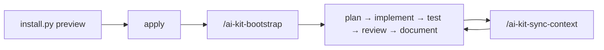
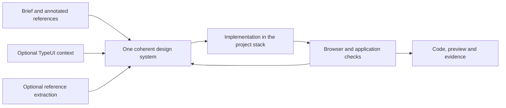
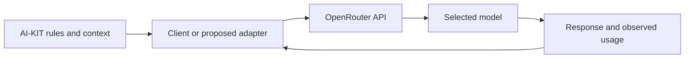

# AI-KIT


**Stop re-explaining your project to every new AI chat.**

AI-KIT gives your coding agents persistent project memory, expert stack rules, **Kubernetes-ready** containers, **adaptive model routing**, and native configuration for **11 AI clients**. Add **Cloudflare security-audit** for structured security review and **Strix** for scoped pentesting workflows. One offline installer, zero installer dependencies, changes previewed before you apply them.

**[v1.4.0](CHANGELOG.md#v140-2026-10-15)** adds a standalone Docker CLI and shared context from two local dialogues: import, human review of contradictions, and exports for ChatGPT/OpenRouter. [Release preparation and verification](docs/V1_4_0.md). Optional Web Design and the extensive README guide remain available without a README size quota.

[](#install)
[](scripts/install.py)
[](#-works-with-your-ai-clients)
[](LICENSE)

[Features](#features-at-a-glance) · [Shared context](#shared-context-from-two-dialogues) · [Web Design](#web-design) · [Docker CLI](#run-ai-kit-with-docker) · [Security workflows](#security-workflows) · [Context7](#library-documentation-with-context7) · [OpenRouter](#working-with-openrouter) · [Quick start](#install) · [Stacks](#-built-for-your-stack) · [Presets](#presets) · [Update](#update-an-application-project)

## Features at a glance

| | Feature | What it does for you |
| --- | --- | --- |
| 🧠 | **Project memory** | Verified facts, module map, commands, and decisions that every new chat reads first |
| 🧩 | **Stack profiles** | Expert rules for Go, PHP, Laravel, Filament 5, Moodle, Python, Rust, .NET, Java, Terraform/Helm, frontend, and libraries, auto-detected per module |
| 🐳 | **Kubernetes-ready containers** | Every new Dockerfile and service ships with probes, graceful shutdown, non-root security, and manifests |
| 🧭 | **Adaptive model routing** | A 0-6 capability ladder that picks the right model role and reasoning effort for each task |
| 🤖 | **11 AI clients** | Codex, Claude Code, Cursor, Copilot, Gemini CLI, Windsurf, Cline, Roo, Aider, Kimi, Manus — with documentation evidence and lifecycle reporting |
| 🎯 | **Native client configuration** | Your real test commands run without prompts; module rules load only where they apply |
| 🛡️ | **Guardrails** | No commits without your request, confirmation before destructive commands, secret files off-limits |
| 🔐 | **Optional security workflows** | Cloudflare's audit method and nine Strix skills, pinned and invoked explicitly in Codex or Claude Code |
| 🎨 | **Optional Web Design** | Annotated references and a brief become a coherent visual system, stack-aware implementation and recorded UI acceptance; includes a dedicated Blade route |
| 🔁 | **Engineering loop** | Plan → implement → test → review → document, with honest reporting of what was really checked |
| ⚡ | **One-command workflows** | `/ai-kit-bootstrap`, `/ai-kit-review`, `/ai-kit-sync-context` |
| 📦 | **Safe installer and upgrades** | Preview first, offline, backups, conflict candidates, explicit unchanged-adapter retirement, your local edits preserved |
| 🐋 | **Docker CLI image** | Run the bundled installer and helpers without host Python; mount your project, preview changes and apply explicitly |
| 🗂️ | **Shared dialogue context** | Import two conversations locally, review conflicting claims and export the same reference state for ChatGPT and OpenRouter |

## Why AI-KIT

AI-KIT preserves facts and decisions, points agents at real checks and records authorization boundaries:

- **Project knowledge:** manifests draft module facts and commands; bootstrap verifies them.
- **Stack depth:** relevant profiles cover framework authorization, transactions, cancellation, privacy and infrastructure review.
- **Your authority:** explicit commits/pushes, optional risky-command guards and secret exclusions.
- **Visible evidence:** unavailable checks remain unverified.



## Feature tour

### 🧠 Project memory that survives every chat

- **Verified context:** PROJECT_CONTEXT and project.json hold contracts, module facts, commands and unknowns.
- **Manifest drafts:** Go, Composer, Node, Python and Moodle evidence suggests versions and module commands until bootstrap confirms them.
- **Session start:** an optional Claude hook reads context and Git status.
- **Continuity:** decisions, ADRs and changelog preserve reasons; the continuity skill keeps context and pointers synchronized.

### 🧩 Built for your stack

| Profile | What the agent gets right |
| --- | --- |
| [Go](template/ai-kit/stacks/GO.md) | Context propagation, timeouts, error wrapping, goroutine ownership, `-race`, govulncheck, deliberate vendoring |
| [PHP](template/ai-kit/stacks/PHP.md) | Composer and PSR boundaries, exact money, bounded HTTP, narrow exceptions, `composer audit` |
| [Laravel](template/ai-kit/stacks/LARAVEL.md) | Policies, bounded transactions, after-commit jobs, idempotent effects, N+1 checks, safe migrations |
| [Filament 5](template/ai-kit/stacks/FILAMENT.md) | Resources, schemas, tables, and actions with server-side authorization, tenant scope, and bounded queries |
| [Moodle](template/ai-kit/stacks/MOODLE.md) | Plugin APIs, capabilities and `sesskey`, upgrade savepoints, Privacy API, cache invalidation |
| [Python](template/ai-kit/stacks/PYTHON.md) | Safe CLIs, pathlib, subprocess without a shell, isolated environments, uv/ruff for new packages |
| [Frontend](template/ai-kit/stacks/FRONTEND.md) | Pinned package manager, type/lint/build checks, accessibility, public-config hygiene |
| [Library/SDK](template/ai-kit/stacks/LIBRARY.md) | Public API stability, semantic versioning, consumer examples, compatibility matrices |
| [Rust](template/ai-kit/stacks/RUST.md) | Ownership and borrowing, unsafe discipline, Result errors, cargo fmt/clippy/test, lockfile hygiene |
| [.NET](template/ai-kit/stacks/DOTNET.md) | Nullable types, async with CancellationToken, deterministic disposal, dotnet build/test |
| [Java](template/ai-kit/stacks/JAVA.md) | Maven/Gradle wrappers, exception boundaries, try-with-resources, wrapper test/verify |
| [Terraform/Helm](template/ai-kit/stacks/INFRA.md) | Remote state, plan review, pinned providers and charts, fmt/validate and lint/template gates |

Profiles combine per module, so a monorepo with a Laravel app in `web/` and a Go service in `api/` gets the right rules in each place. Opinionated **owner conventions** for Laravel (no database foreign keys, public UUID beside the internal id, Policy + Factory + Seeder per model, one table per migration, Filament 5+ for new panels) are available; use `--conventions standard` to follow your project's own conventions instead.

### 🐳 Docker-aware, Kubernetes-ready by default

New containers follow the [Kubernetes-ready contract](template/ai-kit/CONTAINERS.md), including local Docker Compose projects:

- **Images/runtime:** pinned multi-stage images, build secrets outside layers, non-root execution, read-only root, exec entrypoints; no privileged mode or Docker socket.
- **Lifecycle:** startup/readiness/liveness probes, SIGTERM drain, migrations in separate Jobs.
- **Deployment:** ConfigMap/Secret, stdout logs, stateless replicas, PVCs where needed, dropped capabilities, seccomp and resource requests.
- **Preflight/cleanup:** verify Docker client and daemon. Cleanup needs verified disposable ownership and the 10 GB threshold; `scripts/docker_test_usage.py` collects evidence.

### 🧭 Adaptive model routing

Pay for intelligence only where it matters. The [routing policy](template/ai-kit/router/POLICY.md) maps every task to a capability level:

| Level | Task | Role / effort |
| --- | --- | --- |
| 0-1 | Classification, narrow mechanical edits | cheap / none or low |
| 2 | Substantive engineering | work / medium |
| 3-5 | Hard debugging, concurrency, distributed or sensitive correctness | work / high to max |
| 6 | Diagnosed capability shortfall | escalation |

Provider configurations map roles to OpenAI, Anthropic, Kimi, and Gemini models, or your own local/Ollama models. The offline helper understands English and Russian task descriptions and explains its choice:

~~~sh
python scripts/router.py route "debug a race condition in the queue worker"
~~~

`router.py configure` writes the resolved role mapping and a native Aider model file; `router.py providers` lists each provider's tier, status, and sources. The kit never fakes a model switch: when a client offers no switching control, you get a recommendation.

### 🤖 Works with your AI clients

| Client | What gets installed |
| --- | --- |
| Codex | `AGENTS.md` and `.agents/skills/` |
| Claude Code | `CLAUDE.md` importing AGENTS, skills, settings, path-scoped `.claude/rules/` |
| Cursor | `.cursor/rules/` with module globs, `.cursorignore` secrets |
| GitHub Copilot | `copilot-instructions.md` and per-module `.instructions.md` |
| Gemini CLI | `GEMINI.md` and `.geminiignore`; reads the shared skills |
| Windsurf, Cline, Roo | Native rule folders, with glob- or path-scoped module rules for Windsurf and Cline |
| Aider | `CONVENTIONS.md` and `.aiderignore`, plus model routing config |
| Kimi, Manus | Short entry files |

Scoped rules, ignore files, and settings come with the native-settings and scoped-rules extras. The preview spots the clients you already use from existing files and suggests the matching `--agent` list.

### 🎯 Native configuration from your project facts

- **Recorded checks:** Claude allow rules cover test/lint/build commands.
- **Secret exclusions:** shared lists cover env files, keys, Composer auth, Laravel/Moodle credentials and .pypirc through selected client deny/ignore controls.
- **Module scope:** native rules select relevant guidance by file path.
- **Owned entries:** Claude settings merge by key, using local settings in private mode and moving only kit entries on mode switches.

### 🛡️ Guardrails you can trust

- **No surprise commits.** Commits and pushes require your explicit request, and optional Claude Code ask rules back that up.
- **Confirmation before damage.** With data guards, Claude Code asks before `rm -rf`, `git reset --hard`, `git clean`, a Docker prune, or a Laravel/Moodle migration.
- **Security baseline:** input validation, server-side authorization, and no secrets in code, logs, or prompts. Dependency audits run per stack with `composer audit`, `govulncheck`, `pip-audit`, and your package manager's audit.
- **Honest verification:** unavailable tools, services, or CI are reported as unverified, never as passed.

### 🔁 Engineering loop and one-command workflows

Every task follows **plan → implement → test → review → document**, with staged migrations and rollback plans, review by concrete scenario and severity, and a changelog entry for every change. Owner conventions add a Codecov gate of at least 90% of changed lines when Codecov is configured. Three user-invoked skills make the routine instant:

- `/ai-kit-bootstrap` confirms installer drafts and fills context from real evidence.
- `/ai-kit-review` reviews current changes against the engineering and security rules.
- `/ai-kit-sync-context` updates context, decisions, and the changelog after work.

In Codex, use `$ai-kit-bootstrap` and the other skills the same way.

### Security workflows

**v1.1.0 brings established security methods into your coding workflow.** Give your agent a structured audit method for understanding risk, and a separate workflow for testing exploitability with Strix. Choose the capability your task needs; enable either or both.

| Integration | What it adds | Install flag | Codex / Claude Code |
| --- | --- | --- | --- |
| **Cloudflare security-audit** | Security guidance and focused review; a full audit method with reconnaissance, hunting, evidence validation, coverage and reporting | `--with-security-audit` | `$security-audit` / `/security-audit` |
| **Strix** | Workflows for code, web application, API and OWASP testing, findings review and requested remediation; separate CI/cloud references | `--with-strix` | `$strix` / `/strix` |

**Cloudflare: a method for evidence-based review.** The complete upstream skill includes attack-class references, report schemas and Node.js validators. The short entry point loads only relevant material and distinguishes focused guidance from a separately requested full audit. Independent verification, execution isolation and safe evidence handling remain part of that full-audit contract. [Usage and prerequisites](template/ai-kit/SECURITY-AUDIT.md).

**Strix: a path from source review to active testing.** Nine original skills cover local code and deployed targets, API/web testing, OWASP coverage, fixing findings and verification. The AI-KIT entry point prepares scoped local CLI work, checks prerequisites and reviews proof-of-concept evidence, usage and actual coverage. CI and managed-cloud guidance is available when specifically requested. [Runtime and scan contract](template/ai-kit/STRIX.md).

Preview both integrations in an application project:

~~~sh
python scripts/install.py /path/to/my-app --agent codex --agent claude --with-security-audit --with-strix
~~~

Review the preview, then repeat with `--apply --check`. Use either flag alone to select one integration; the `aikit install` command accepts the same flags. Invoke the installed skill with a concrete scope, for example in Codex:

~~~text
$security-audit Review authentication and tenant isolation in api/. Use guidance mode and report evidence and validation gaps.
$strix Prepare a local scan of a disposable copy of api/. Agree the model, scope, budget and time limit before execution.
~~~

In Claude Code use `/security-audit` and `/strix`. Other clients can explicitly follow the installed source entry points.

- **Controlled discovery:** both are off by default and outside presets. Explicit selections persist; Codex/Claude metadata prevents implicit invocation. Supporting references stay outside native skill discovery.
- **Traceable inputs:** Cloudflare is pinned at `c1c8a8c…` ([manifest](integrations/security-audit.json), MIT); Strix at `f7a32ae…` ([manifest](integrations/strix.json), Apache-2.0). The installer checks file coverage, sizes, Git blobs and SHA-256 and preserves original bytes/licenses.
- **Preserved customization:** existing backup/conflict rules protect local adaptations; private/team visibility follows the kit's instruction policy.

Installation stays offline and copies files only. A Strix scan requires a separately configured CLI, Docker and model access, plus authorized targets and limits; local code mounts are writable, so use an isolated copy. Cloudflare's pinned validator CLI needs OS no-follow/nonblocking input protection and refuses unsupported native Windows inputs. Installation establishes neither a running audit nor complete vulnerability coverage; [integration verification](docs/STRIX.md#verification) records what was tested.

### More built in

- **Language/sharing:** English files, Russian chat by default; private or team instructions.
- **Health:** `scripts/doctor.py` reports managed-file, link, provider and context drift; `--fix` preserves local edits.
- **Measurements:** `scripts/metrics.py` records supplied attempt/token/cost evidence and analyzes provider results. No automatic telemetry; evaluation checks opaque pair coverage.

## Install

You need Python 3.10 or later; the installer uses only the standard library.

~~~sh
git clone https://github.com/tigusigalpa/ai-kit.git
cd ai-kit
~~~

Use a reviewed revision and an application path outside this directory.

**1. Preview.** Nothing is written:

~~~sh
python scripts/install.py /path/to/my-app --preset solo --agent codex --agent claude
~~~

On Windows use a path like `"C:\Projects\my-app"`. The preview lists writes, preserved files, conflicts, and detected stacks/clients. Add `--interactive` for a guided prompt.

**2. Apply** the same command with `--apply`; add `--check` to run the doctor right away:

~~~sh
python scripts/install.py /path/to/my-app --preset solo --agent codex --agent claude --apply --check
~~~

**3. Bootstrap.** Open your AI client in the project and run `/ai-kit-bootstrap` (Claude Code) or `$ai-kit-bootstrap` (Codex). For other clients, give it [BOOTSTRAP_PROMPT.md](BOOTSTRAP_PROMPT.md).

Existing project documents and context are never overwritten; customized instructions become reviewable conflicts.

Every command also runs through one CLI: `python aikit_cli.py install|doctor|route|metrics|benchmark|check|…` (or `aikit …` after `pip install -e .`).

## Run AI-KIT with Docker

**Build AI-KIT once, then run its CLI against a mounted application folder.** The image contains Python, Git, the packaged kit and all optional integration resources. Installation and the ordinary offline helpers need no host Python or network access at runtime. Each command exits when it finishes; there is no server to keep running.

This is an alternative way to run the same installer. Open your coding agent in the application afterward and bootstrap normally. The image supplies neither an AI agent nor a model API adapter. Web Design, Context7, Cloudflare security-audit and Strix remain opt-in instruction modules; their external tools and live execution require separate setup.

### Build the local image

Use Docker with Linux containers and a running daemon. Check the actual selected context before building:

~~~sh
docker context show
docker version
~~~

From a reviewed AI-KIT checkout, build the version recorded in `VERSION`. In PowerShell:

~~~powershell
$kitVersion = (Get-Content -LiteralPath .\VERSION -Raw).Trim()
docker build --build-arg "AIKIT_VERSION=$kitVersion" --tag "ai-kit:$kitVersion" .
~~~

On Linux or macOS:

~~~sh
kit_version="$(cat VERSION)"
docker build --build-arg "AIKIT_VERSION=$kit_version" --tag "ai-kit:$kit_version" .
~~~

The build refuses a missing or mismatched `AIKIT_VERSION`. The Dockerfile pins the Python base by digest and build tools by version and wheel hash. Building downloads those tools and Debian packages; subsequent CLI execution can be offline. Git's Debian package is resolved at build time, so identical rebuilds are not promised. Record the resulting image identity when distributing a reviewed build. These commands create a local image; they do not upload it to a registry.

The closed `.dockerignore` includes distribution sources and excludes Git, personal client configuration, common credential files, private design output, journals and caches. Review new resources before extending its allowlist. Build from the kit checkout; application files enter through the runtime mount.

### Docker Hub image

**Published image:** [tigusigalpa/ai-kit:1.4.0](https://hub.docker.com/r/tigusigalpa/ai-kit/tags?name=1.4.0), for `linux/amd64`. Download with `docker pull tigusigalpa/ai-kit:1.4.0`. The mount examples below use the local name `ai-kit:1.4.0`; give the downloaded image that alias with `docker tag tigusigalpa/ai-kit:1.4.0 ai-kit:1.4.0` and set the version variable to `1.4.0`, or use the full namespaced image name in your commands. [Publication record](docs/V1_4_0.md#docker-hub-publication) records the verified digest. No `latest` tag was assigned and no automated registry push is configured.

### Preview and apply on Windows

Choose an existing application folder outside the AI-KIT distribution. Use its absolute path, including quotes when it contains spaces. In the same PowerShell session:

~~~powershell
$appPath = (Resolve-Path -LiteralPath 'C:\Projects\my-app').Path
$image = "ai-kit:$kitVersion"
$runtime = @('--rm', '--init', '--network', 'none', '--read-only',
    '--cap-drop', 'ALL', '--security-opt', 'no-new-privileges',
    '--tmpfs', '/tmp:rw,nosuid,nodev,size=256m')

# Preview: the project mount is read-only and the installer writes nothing.
docker run @runtime --mount "type=bind,source=$appPath,target=/workspace,readonly" $image install /workspace --agent codex --with-web-design

# After reviewing the preview, apply with a writable project mount.
docker run @runtime --mount "type=bind,source=$appPath,target=/workspace" $image install /workspace --agent codex --with-web-design --apply --check

# Later health checks can use a read-only project mount.
docker run @runtime --mount "type=bind,source=$appPath,target=/workspace,readonly" $image doctor /workspace
~~~

Select the same agents, presets and `--with-*` options in preview and apply. Add `--agent claude`, `--with-context7`, `--with-security-audit` or `--with-strix` when wanted. Existing project documents, local settings, MCP configuration and edited managed files follow the normal preservation/conflict rules. Files written to `/workspace` persist in the host folder after the container is removed.

### Preview and apply on Linux or macOS

Run from an ordinary host user. Forward that user's UID/GID so the bind-mounted project and new files have usable ownership; the image's default UID/GID is `10001:10001`. In Bash:

~~~sh
app_path="$(cd /path/to/my-app && pwd)"
image="ai-kit:$kit_version"
runtime=(--rm --init --network none --read-only --cap-drop ALL
  --security-opt no-new-privileges --tmpfs /tmp:rw,nosuid,nodev,size=256m
  --user "$(id -u):$(id -g)")

docker run "${runtime[@]}" --mount "type=bind,source=$app_path,target=/workspace,readonly" \
  "$image" install /workspace --agent codex --with-web-design

# Run after reviewing and approving the preview.
docker run "${runtime[@]}" --mount "type=bind,source=$app_path,target=/workspace" \
  "$image" install /workspace --agent codex --with-web-design --apply --check
~~~

Do not forward UID `0`; grant a chosen non-root UID access to the project instead. The container does not change host ownership automatically. Docker Desktop file-sharing permissions and remote-daemon paths must also permit the mount. If Git reports dubious ownership, use matching ownership and a narrowly reviewed Git configuration; the image does not globally trust every directory.

### Other commands and writable paths

Arguments after the image name go directly to `aikit`. Reuse the runtime options above:

~~~powershell
docker run @runtime $image --help
docker run @runtime $image check
docker run @runtime $image route 'review an interface'
docker run @runtime --mount "type=bind,source=$appPath,target=/workspace,readonly" $image context select /workspace --workflow web-design
~~~

`check` validates the bundled distribution. `doctor /workspace` validates the installed project. Read-only reports need a read-only project mount; explicit writes such as `install --apply`, `context snapshot --apply`, configuration or local records need a writable mount. The root filesystem stays read-only, with temporary storage in `/tmp`. Interactive installation also needs `-it`.

| Runtime contract | Value |
| --- | --- |
| Entrypoint and default command | `aikit`, `--help` |
| Default Linux identity | UID/GID `10001:10001` |
| Working directory and project mount | `/workspace` |
| Temporary writable storage | `/tmp`, provided by the caller |
| Network and ports | Offline examples; no exposed ports |
| Shutdown | Foreground CLI receives SIGTERM; use `--init` to forward signals and reap children |
| Completion | CLI exit code: installer 0 success, 1 refusal, 2 unresolved conflicts |

Stopping an installation is not a rollback operation. After an interruption, inspect the project, run `doctor` and preview again before continuing. The container smoke test checks SIGTERM while waiting in an interactive preview; it does not establish atomic cancellation during writes.

Framework toolchains, browsers, Node/Composer, model workers, MCP connections and the Strix executable are separate. Benchmark workers need their own reviewed runtime and project dependencies. The Docker inspection helper (`aikit docker`) runs on the host with Docker access; this CLI image does not mount the Docker socket or bundle a Docker client.

### Kubernetes preview Job

[install-preview-job.yaml](deploy/k8s/install-preview-job.yaml) runs one read-only installation preview against an existing `aikit-project` PVC. It sets a non-root identity, read-only root, dropped capabilities, no API token, an explicit deadline and no automatic retries. `/tmp` uses `emptyDir`; project data uses the PVC.

Its `ai-kit:local` image with `imagePullPolicy: Never` is a local-cluster example. Load/tag the reviewed image in the intended test cluster, or replace it with your registry image pinned by digest and an appropriate pull policy. Ensure UID `10001` can read the PVC. Initial CPU/memory requests and limits are estimates, not measured recommendations. A one-shot CLI reports completion through its exit code, so this Job needs no Service or HTTP probe. Before deployment, verify the actual cluster version, context, namespace, storage and resource requirements. Local schema checks do not establish a successful cluster run.

### Verify or update the image

~~~sh
python scripts/check_kit.py
python -m unittest discover -s tests -v
python tests/docker_smoke.py ai-kit:1.4.0 --context .
~~~

Use the tag you actually built. The Docker smoke uses disposable synthetic projects, no runtime network and Docker's actual ignore engine; it checks preview/apply, all optional modules, preservation, rerun stability, read-only refusal and SIGTERM. CI builds and tests a local image without publishing it. [Maintainer contract and results](docs/DOCKER.md) records pins, packaging, checks and unavailable environments.

For an upgrade, review the new kit revision, rebuild with its `VERSION`, preview against the same application folder and then apply normally. Review base/tool updates and rerun the image checks. After testing, measure only identifiable project test volumes/cache; follow the canonical [cleanup policy](template/ai-kit/CONTAINERS.md#post-test-docker-cleanup). A shared builder does not prove project ownership, and no automatic unscoped prune is part of this workflow.

## Choose your defaults

Project choices live in `ai-kit/settings.json`; defaults are in [the settings template](template/ai-kit/settings.json).

| Setting | Default | Meaning |
| --- | --- | --- |
| Project language | English | Authored project files use English |
| Chat language | Russian | Plans, explanations, and replies use Russian |
| Sharing mode | private | Local AI-KIT files are excluded from Git |
| Conventions | owner | Personal Laravel conventions apply when that stack is confirmed |
| Agent selection | codex | Default entry points and source skills |

~~~sh
python scripts/install.py /path/to/project --mode team --chat-language English --conventions standard --agent codex --agent claude
~~~

**Read [OWNER.md](template/ai-kit/profiles/OWNER.md) before adopting owner conventions for Laravel**; standard follows established project conventions.

### Presets

| Preset | Mode | What it adds |
| --- | --- | --- |
| minimal | unchanged | Instructions only |
| solo | private | Session-start context, native client settings, scoped module rules |
| team | team | solo plus Git commit/push confirmation |
| strict | unchanged | team plus confirmation before destructive and migration commands |

Explicit `--mode` and `--with-*` flags override presets; previews report disabled extras. CI and both security workflows remain explicit choices outside presets. [All extras and client formats](template/ai-kit/ADAPTERS.md#optional-install-extras).

## What lands in your project


| File or directory | Purpose |
| --- | --- |
| AGENTS.md | Starting instructions and links to relevant rules |
| PROJECT_CONTEXT.md | Verified purpose, contracts, stack, module map, commands, and open questions |
| WIKI.md | A short map of useful documentation |
| .agents/skills/ | Stack skills, the continuity procedure, and the ai-kit workflows |
| ai-kit/ | Core rules, settings, project facts, engineering, security, containers, profiles, and routing |
| docs/DECISIONS.md and docs/adr/ | Decisions, reasons, and tradeoffs |
| CHANGELOG.md | What changed and why |

[Core](template/ai-kit/CORE.md) owns language, Git authorization, and fact verification; the [engineering guide](template/ai-kit/ENGINEERING.md) owns the work cycle.

## Sharing

| Mode | Shared AI-KIT files in Git | Suitable for |
| --- | --- | --- |
| private | Ignored | Local instructions installed separately |
| team | Visible | Teammates and agents working from fresh clones |

Both modes exclude secrets, personal overrides, installer state, caches, IDE folders, AI client history, and extracted AI-KIT bundles; private mode also keeps AI client configuration folders (`.cursor`, `.codex`, `.gemini`, `.windsurf`, `.roo`, Copilot prompts and agents) out of Git. The installer owns one marked `.gitignore` block; your other rules survive, and lockfiles and manifests stay visible. Composer, Moodle, Node, and Python exclusions are scoped to detected modules, preserving deliberate Go vendoring. See [ignore adaptation](template/ai-kit/BOOTSTRAP.md#ignore-adaptation).

## Update an application project


Preview a newer bundle against the same path. Unchanged managed files update, while your context and history are preserved. Locally adapted files become candidates under `ai-kit/.upstream-cache/candidates/` for review, and changed files are backed up first. After merging a candidate, accept it:

~~~sh
python scripts/install.py /path/to/project --accept-local AGENTS.md --apply
~~~

Exit codes: 0 success, 1 refusal, 2 unresolved conflicts. The installer works offline; agents check the configured upstream through [UPSTREAM](template/ai-kit/UPSTREAM.md). Run `python scripts/doctor.py /path/to/project` anytime for a health report.

## Honest boundaries


Routing recommends controls; confirm actual client activation. Permission rules and ignores reduce risk without being a security boundary. The optional benchmark requires an explicitly configured worker; no live vendor adapter is shipped.

## Measure, recommend and select context


- `aikit benchmark run TARGET --pack PRIVATE_PACK`: isolated, resumable A/B/C trials through a reviewed worker, configurable kit arms and private reports. Fixed models, actual telemetry and semantic review underpin comparisons. [Contract](docs/BENCHMARK.md).
- `aikit route "task" --project TARGET --mode adaptive`: recommendations from sufficient comparable cost/quality history; explicit pins win. `metrics compare|stacks|propose|restore` analyzes without automatic selection changes. [Policy](template/ai-kit/router/POLICY.md#modes-pins-and-optimization-profiles).
- `aikit context select TARGET --path api --budget 32000`: module rules, duplicate detection and byte accounting; critical requirements survive budgets. [Development stages](docs/DEVELOPMENT_PLAN.md).

## Web Design


**Give your agent the sites you like, a short brief and the target project.** The optional Web Design module organizes that material into a coherent visual direction, reusable components and a working interface with recorded checks. It supports new websites and existing interfaces, with a detailed Laravel/Blade route and conditional guidance for Tailwind, Bootstrap, Alpine, Livewire, daisyUI, Flowbite and Flux.

AI-KIT supplies the workflow and project memory; the connected coding agent performs the work. TypeUI can supply a chosen design system, SkillUI can supply reference observations, and an available browser can verify the result. Those tools are separate, optional capabilities. Installing this module does not create an account, download npm/Composer packages, connect MCP, launch a browser, generate a site automatically or deploy it.

The installed [Web Design contract](template/ai-kit/WEB-DESIGN.md) is the canonical agent workflow. This section explains how to use it, choose a route and understand the result. The root README has no size quota; compact agent entry points and conditional instruction budgets remain separate.



### Install Web Design

Use a target application outside the AI-KIT checkout. Preview first:

```bash
python scripts/install.py /path/to/client-site --with-web-design --agent codex --agent claude
```

For a Windows target with spaces, the equivalent is:

```powershell
python scripts/install.py 'C:\Projects\Client Site' --with-web-design --agent codex --agent claude
```

Review the reported writes, preserved files, conflicts and warnings. When the requested installation is approved, repeat the same command with `--apply --check`. An installed wheel exposes the same option:

```bash
aikit install /path/to/client-site --with-web-design --agent codex --agent claude --apply --check
```

Select only the clients you actually use. The module's four skills use normal relevant discovery; Codex receives source skills and selecting Claude also creates native copies. Other supported clients can follow the same canonical documents even when their skill discovery differs. File installation does not prove discovery in the running client: start/reload the client as needed and verify that the intended skill is available.

`--with-web-design` persists `web_design=true` in `ai-kit/settings.json`. It is independent of presets, security-audit, Strix and Context7. None of the presets enables it for a fresh project; an already enabled choice survives a later preset change. Add `--with-context7` separately if you want that documentation workflow, then connect its MCP server separately when needed.

### What the module installs

| Project path | Purpose | Update behavior |
| --- | --- | --- |
| `ai-kit/WEB-DESIGN.md` | Shared brief/reference/design/implementation workflow | Managed instruction; local adaptations are preserved or become reviewed conflicts |
| `ai-kit/web-design/LARAVEL.md` | Blade contracts, Tailwind/Bootstrap assets and Alpine/Livewire ownership | Conditional implementation reference |
| `ai-kit/web-design/LIBRARIES.md` | Selecting and using daisyUI, Flowbite or Flux | Read only for the selected library |
| `ai-kit/web-design/TOOLS.md` | TypeUI, external skills, browser analysis and SkillUI | Read only when that tool route applies |
| `ai-kit/web-design/REVIEW.md` | Responsive, interaction and accessibility acceptance | Evidence protocol for changed screens |
| `.agents/skills/web-design/` | Visual design from a brief/references or a requested redesign | Short skill with normal relevant discovery |
| `.agents/skills/laravel-blade-ui/` | Implementation in confirmed Blade interfaces | Does not force all Laravel frontends to Blade |
| `.agents/skills/ui-review/` | UI review and acceptance after changes | Uses available project/browser tools |
| `.agents/skills/design-extract/` | Requested reference analysis/extraction | Does not run an external CLI automatically |
| `docs/design/BRIEF.md` | Project audience, scope, content and annotated references | Created only when missing; existing bytes are preserved |
| `docs/design/SYSTEM.md` | Chosen visual rules, components, tokens and tool provenance | Project-owned memory, preserved by upgrades |
| `docs/design/ACCEPTANCE.md` | Required states, checks and actual evidence | Project-owned memory, preserved by upgrades |

Selecting Claude adds matching `.claude/skills/` copies. The source and native wrappers point to the same canonical rules. The installer does not bundle upstream TypeUI, Anthropic, Vercel or daisyUI skills; it supplies local, bounded guidance and primary-source links.

Fresh projects without the flag receive none of this module's skills, guides or design documents. Its registry/navigation entries are also omitted, so the default installation does not contain broken links to optional files. An existing project WIKI is preserved: during bootstrap, add pointers to the actual design documents rather than expecting the installer to rewrite your wiki.

### Give the agent a useful brief

You can start with a few paragraphs. Supply the information you know; unknowns need not block all work:

| Input | A useful description |
| --- | --- |
| Subject and audience | What the site offers, who uses it and what they need to understand |
| Main action | Contact the team, book a service, buy a product, read documentation or another concrete outcome |
| Structure | Required pages and sections, their purpose and approximate content |
| References | Links plus what you like about each: typography, composition, density, imagery or interaction |
| Materials | Logo, brand colors, text, photographs, icons and the rights/provenance of supplied assets |
| Behavior | Forms, search, account, CMS, payments, filters and other actual application requirements |
| Existing project | Its path, current pages/components and known Laravel/frontend versions |
| Language and constraints | User-facing language, device needs, accessibility, hosting or integration constraints |

A reference list is much more useful when annotated: the first site may contribute its readable typography, the second its section rhythm and the third its navigation behavior. The agent should reconcile those observations into one system rather than assemble unrelated fragments. If a reference cannot be accessed, it records that gap and works from available evidence or supplied images; it must not invent the page's contents.

AI-KIT keeps English authored project files and the configured chat language. State the required user-facing language explicitly when it differs, and preserve supplied user content. Do not place secrets, session cookies, private customer records or account credentials in a brief. Confidential raw material can remain in an agreed private location with sanitized pointers in the ordinary design documents.

### Start the workflow in your coding agent

After installation/bootstrap, invoke the main skill when useful:

```text
$web-design Build the website described in docs/design/BRIEF.md. Analyze the annotated references, reuse the project's confirmed stack, establish one design direction, implement the required pages and record actual acceptance evidence. Proceed within the requested local scope and resolve material unknowns as needed.
```

Claude Code uses `/web-design` instead of `$web-design`. Clients without this invocation form can be asked to read `ai-kit/WEB-DESIGN.md` and the project design documents directly. For an existing interface, narrow the request:

```text
$web-design Refine the pricing page using the existing design system. Improve hierarchy and mobile layout, preserve the current components and behavior, and check the changed page and form states.
```

The agent first inspects the actual project, reads existing design decisions and identifies material unknowns. It can propose a compact visual plan or a representative screen when the direction is new. A separate approval round is not imposed on every ordinary task; user preferences and the authorization needed for actual external actions determine where a pause is necessary.

### Keep design memory in the project

Use three documents with distinct responsibilities:

- **BRIEF:** audience, outcome, pages, real content, functional requirements and annotated references.
- **SYSTEM:** the chosen visual direction, token roles, responsive rules, component APIs and source/tool identity.
- **ACCEPTANCE:** the required routes/states and observed checks, including failures and unavailable runtime coverage.

If your project already has `docs/design-system.md`, a brand guide or a product specification, link those authoritative documents from the new files. Do not copy the same rules into every skill or create a second conflicting design system. For monorepos, record applicable paths/surfaces and link module-specific documents where needed.

The installer creates missing scaffolds with unknown fields; it does not infer that your site is Laravel, Tailwind or a particular visual style. Later installs preserve existing design document bytes, including files written before AI-KIT was installed. `--accept-local` applies to selected managed instructions, not these project-owned documents.

Private sharing mode hides kit/client configuration. Team mode shares the instructions. **The three design documents are ordinary project documentation visible in both modes.** Keep them suitable for the repository's audience. Working screenshots, reports and extraction data can stay in `ai-kit/.design/`, ignored in both modes; intended public website assets belong in the project's normal asset directories. Ignoring a path does not remove already tracked files.

### Select design context without loading every tool

The context helper can select the relevant workflow explicitly:

```bash
aikit context select /path/to/client-site --path web --workflow web-design --budget 32000
aikit context select /path/to/client-site --path web --workflow ui-review
aikit context select /path/to/client-site --path web --workflow design-extract
```

For a root project use `--path .`, or omit it. From the source checkout, prefix these commands with `python aikit_cli.py` instead of `aikit`.

Ordinary `context select` continues to select stack/Core/architecture context without adding the Web Design module. A design workflow requires `web_design=true`, adds the workflow entry and all three project documents, and retains them even when the requested byte budget is small. Confirmed Laravel/Filament module profiles also select Blade implementation guidance for the main design workflow; actual Blade usage still needs verification. Other languages and plain HTML do not receive assumed Laravel facts.

The helper returns paths, hashes and measured bytes, not an assembled model prompt or an API call. A plain HTML project may have no declared manifest-based module; the selected design workflow still works, while the report honestly leaves module coverage unestablished. Library/tool guides remain conditional reads selected by the agent from the actual task. No tokenizer or runtime-loaded-context savings is claimed.

### Turn a reference set into one visual direction

Ask the agent to identify the audience and the primary job of each page before choosing decoration. A useful plan covers:

- Information hierarchy and the order of sections, grounded in real content.
- A small semantic palette for brand, surface, text, border and functional states.
- Typeface choices, supported scripts, type scale and readable line lengths.
- Containers, grids, spacing rhythm and how composition changes on narrow screens.
- Reusable component states and one or more deliberate visual accents that serve the brief.
- Imagery, motion and reduced-motion behavior, with available assets and fallbacks.

These are decision criteria, not a compulsory look. Rounded cards, gradients, serif type and a restrained layout can all be appropriate when the brief calls for them. Avoid replacing one generic style with another universal ban. For an established product, consistency may matter more than novelty.

Anthropic's [frontend-design](https://github.com/anthropics/claude-code/blob/main/plugins/frontend-design/skills/frontend-design/SKILL.md) supports this method: ground choices in the subject, plan against the brief, build and critique. AI-KIT applies the useful principles through its own workflow. It does not install that external skill or let its aesthetic defaults override the user.

### Choose the implementation route from the actual project

| Project situation | Recommended approach |
| --- | --- |
| New content/marketing website with a chosen Laravel backend | Blade with a selected CSS system; add only the interaction needed |
| Existing Blade + Tailwind project | Reuse its version, tokens, layouts and component contracts |
| Existing Bootstrap site | Keep Bootstrap and improve its tokens/layout/components unless a migration is requested |
| Existing React/Vue/Inertia interface | Keep the actual frontend boundary and apply the design system there |
| Livewire application | Reuse its state/lifecycle conventions and choose compatible controls |
| Existing Filament panel | Follow the confirmed Filament profile, Resources/Pages and theme conventions |
| Plain HTML/CSS website | Work directly with its files and available checks; no package manifest is required merely for this module |

For a new Blade project, Tailwind is a useful starting choice when you want direct token and layout control. Alpine can handle local menus/tabs/disclosures; Livewire can handle server-reactive scenarios. Neither is mandatory for every page. Existing CSS and component systems take precedence over a default recommendation.

One primary visual system per surface is a good default. Different surfaces can have different documented stacks: a marketing site and a Filament admin panel do not need identical component internals. A deliberate migration can cross boundaries, but adding Bootstrap, Tailwind, daisyUI, Flowbite and Flux to the same page by default creates unnecessary collisions.

### Laravel: implement the design directly in Blade

The `laravel-blade-ui` skill complements the existing Laravel/PHP/Frontend profiles. It does not replace their security, data or owner conventions. Inspect Composer/frontend manifests and locks, routes, layouts, components and the real asset pipeline before generating files.

A possible project layout is:

```text
resources/
  css/app.css
  js/app.js
  views/
    layouts/app.blade.php
    components/
      ui/button.blade.php
      ui/input.blade.php
      ui/alert.blade.php
      ui/empty-state.blade.php
      marketing/feature-card.blade.php
    pages/marketing/home.blade.php
docs/design/
  BRIEF.md
  SYSTEM.md
  ACCEPTANCE.md
```

This is an example, not a forced directory migration. Laravel supports anonymous components in `resources/views/components`, including dot notation such as `<x-ui.button>`. Define props, slots, variants and attribute forwarding so styling changes do not break consumers. Extract repeated semantics/behavior; a one-off fragment does not automatically deserve a component. [Official Blade components](https://laravel.com/docs/blade).

The interface must use real routes and form methods, CSRF protection, escaped output, server validation and appropriate policies. Preserve input values and show actionable validation errors. Hidden buttons do not authorize server actions; a success toast does not prove persistence. Use the project's PHPUnit/Pest/Livewire checks for affected server behavior and a browser for interaction.

For a design that starts in TypeUI or an HTML prototype, carry over the chosen tokens, hierarchy and component intent into the real Laravel implementation. A separate React generation-and-conversion stage is not required. If a supplied prototype already uses another framework, assess what can be reused and the cost of adaptation instead of claiming an automatic lossless export.

### Tailwind with Laravel: source discovery and stable classes

Confirm the installed Tailwind major version. The following example is for v4; existing v3 projects keep their version-specific configuration until an upgrade is requested. The official Laravel/Vite guide uses `@tailwindcss/vite`, a Tailwind import, source entries and Laravel's `@vite` asset inclusion. Preserve the project's chosen package manager, lock and plugin configuration. [Laravel installation guide](https://tailwindcss.com/docs/guides/laravel).

An illustrative `resources/css/app.css` for a v4 Blade project:

```css
@import "tailwindcss";

@source "../**/*.blade.php";
@source "../**/*.js";
@source "../../vendor/laravel/framework/src/Illuminate/Pagination/resources/views/*.blade.php";
@source "../../storage/framework/views/*.php";

@theme {
  --color-brand: #155e75;
  --color-brand-strong: #0e7490;
  --color-surface: #f8fafc;
  --color-ink: #0f172a;
  --color-border: #cbd5e1;
  --radius-control: 0.625rem;
}
```

Choose values from the actual approved design, not this example. `@source` paths are relative to the stylesheet; verify source detection for the real directories and selected library. v4 also has automatic discovery, so the absence of one identical glob is not proof of a bug. Confirm that the production build emits the classes actually used.

Tailwind scans text. A fragment such as `bg-{{ $color }}-600` will not reliably produce its eventual class. Use complete class strings or a deliberately bounded `@source inline()` set. For arbitrary runtime values, validated CSS custom properties may be more suitable. [Class detection](https://tailwindcss.com/docs/detecting-classes-in-source-files).

For example, an anonymous `button.blade.php` can keep complete variant classes:

```blade
@props(['variant' => 'primary', 'type' => 'button'])

@php
    $variants = [
        'primary' => 'bg-brand text-white hover:bg-brand-strong focus-visible:outline-brand',
        'secondary' => 'bg-white text-ink ring-1 ring-border hover:bg-surface focus-visible:outline-ink',
    ];
@endphp

<button type="{{ $type }}" {{ $attributes->class([
    'inline-flex items-center rounded-control px-4 py-2 font-medium focus-visible:outline-2 focus-visible:outline-offset-2 disabled:opacity-50',
    $variants[$variant] ?? $variants['primary'],
]) }}>
    {{ $slot }}
</button>
```

This shows a variant map and explicit button type; it is not a complete form component library. Add the actual project's loading, error, icon and accessibility contract where needed. Do not strip `aria-*`, `data-*`, Alpine or Livewire attributes when wrapping controls.

### Bootstrap with Laravel: keep overrides and assets deliberate

Bootstrap is a valid route for an existing project or a deliberately chosen component vocabulary. Verify its version and the actual Sass/JavaScript pipeline. For Sass variables, put overrides before the import that consumes them:

```scss
/* resources/scss/app.scss */
$primary: #155e75;
$border-radius: 0.625rem;

@import "bootstrap/scss/bootstrap";

/* Additional project CSS rules can follow the Bootstrap output. */
```

For partial imports, follow Bootstrap's dependency order, including functions before overrides that use them. CSS variable adjustments and ordinary selector overrides can be applied later; changing a Sass variable after compilation does not regenerate already emitted rules. [Bootstrap Sass customization](https://getbootstrap.com/docs/5.3/customize/sass/).

If the confirmed asset entry is JavaScript, it can import the stylesheet and required plugins:

```javascript
// resources/js/app.js
import '../scss/app.scss';
import { Dropdown, Modal } from 'bootstrap';

// Initialize or use the selected plugins according to the page lifecycle.
```

Use the corresponding Laravel Vite entry in the layout, and check the emitted manifest. Avoid adding both an independent stylesheet entry and a JavaScript import without considering the existing output contract. Include the needed Popper dependency for the selected plugins. A `modal` or `dropdown` class alone does not establish working behavior. [Bootstrap/Vite](https://getbootstrap.com/docs/5.3/getting-started/vite/), [Laravel/Vite](https://laravel.com/docs/vite).

### daisyUI, Flowbite and Flux: select a library for a reason

These are component libraries, not interchangeable design skills. Use the one that fits the actual project and required controls; installing Web Design chooses none of them.

| Library | Useful when | What still needs attention |
| --- | --- | --- |
| **daisyUI** | You want concise component classes and semantic themes in Blade | Behavior, accessible markup, application contracts and theme contrast |
| **Flowbite** | You want selected interactive widgets and supported blocks | Theme/plugin/source setup, JavaScript and initialization after navigation/DOM updates |
| **Flux** | You are building a compatible Livewire interface | Supported package versions, resource ownership and free/Pro component availability |

**daisyUI can live inside your own Blade components.** Its `btn`, `input` and other classes can implement a stable `<x-ui.button>` API. This gives the project reusable contracts without requiring every consumer to know library internals. daisyUI styling does not itself supply Laravel validation or every state transition. [Laravel fit](https://daisyui.com/laravel-component-library/).

The official daisyUI agent skill exists, but its reviewed entry broadly tells the agent to use daisyUI for HTML/JSX even without an explicit request. AI-KIT therefore does not auto-install it or adopt that trigger universally. If you separately add a library skill, scope it to projects/surfaces where the library is selected, review its real files and retain the project's brief as the visual authority. [Official skill](https://github.com/saadeghi/daisyui/blob/master/skills/daisyui/SKILL.md).

**Flowbite** requires its selected version's CSS/theme/plugin/source configuration and JavaScript for interactive components. The Laravel guide demonstrates the setup, but a static example does not prove correct behavior after Livewire updates or client navigation. Check repeated opening/closing, focus return, Escape, scrolling and listener cleanup. Use the existing asset pipeline rather than introducing an unrelated unpinned CDN. [Laravel setup](https://flowbite.com/docs/getting-started/laravel/).

**Flux** is built for Livewire. Its current installation page lists Laravel 10+, Livewire 3.7+ and Tailwind 4.2+; verify compatibility against your actual locked versions when adopting it. Flux Pro is separate from the free package, and the available control set matters before choosing it. Keep Composer authentication/license credentials private. [Flux installation](https://fluxui.dev/docs/installation).

Check each selected library's actual license for the components, blocks and assets you adopt. Avoid installing multiple component systems simply because they appeared in a recommendation list. The [conditional library reference](template/ai-kit/web-design/LIBRARIES.md) covers these decisions.

### Alpine and Livewire: own the behavior once

Alpine is useful for local disclosures, tabs and similar interactions. Livewire is useful when the interface needs server-reactive state. Ordinary Laravel forms can submit to controllers with server validation without adding Livewire.

When Livewire is present, inspect its installed major version and resource strategy. Modern Livewire includes and initializes Alpine; a second standalone Alpine import or CDN copy can cause initialization errors. Manual bundling/plugins should use the supported integration. Resource directives and automatic injection depend on the actual version/layout/configuration; adding script tags by habit can create duplication. [Livewire installation](https://livewire.laravel.com/docs/installation).

Check component roots, stable keys and DOM ownership. A third-party date picker/modal/dropdown must survive the relevant navigation and updates, initialize once and dispose correctly. On the server, validate inputs, authorize actions and scope queries. UI polish does not replace the existing Laravel/Filament security contract.

### TypeUI: use its design context in the coding project

TypeUI can be a useful source of the visual system in this workflow. Its documented role is to give a connected coding agent design context while that agent builds the interface. The site code belongs in your project; hosting/deployment is a separate capability. [TypeUI overview](https://www.typeui.sh/docs).

For your own references and brief, the route is:

1. Analyze the annotated references into concrete design observations.
2. Choose one coherent direction and record it in the local design system.
3. Select/adapt a TypeUI theme or prepare a custom Markdown ZIP in its supported format. Figma import is another documented route; check its current availability.
4. Review the workspace draft and publish the intended system for MCP when that external action is authorized.
5. Connect the account through your client's supported authentication flow, verify actual available resources, and select the intended system.
6. Ask the coding agent to implement the brief in the confirmed project stack using that selected system.
7. Verify the rendered pages and real behavior, then update local design memory with the system/package used.

The documented MCP endpoint is:

```text
https://mcp.typeui.sh/mcp
```

Follow the service's current [MCP setup](https://www.typeui.sh/docs/overview/mcp-server) for the client you use. AI-KIT does not write this server configuration or authenticate an account. Reuse a working connection when present, and make a small retrieval before claiming activation. Keep account tokens outside repository docs/config examples.

Custom design systems are editable Markdown files describing brand, colors, typography, layout and component rules. Use the current import format rather than assuming any ZIP will work. Arbitrary reference URL lists are not a documented automatic import; the coding agent must analyze them first. [Design systems](https://www.typeui.sh/docs/creative/design-systems).

Use one selected visual system per surface. Keep AI-KIT's general engineering, Laravel and review rules active, while avoiding conflicting aesthetic prompts. Record the workspace system/version and a local export or identity of the exact retrieved package where available: remote saved content may change, and a source repository revision does not pin a hosted system. If TypeUI is unavailable, local tokens/components remain a workable route; report retrieval as unverified.

An example request after a verified connection:

```text
$web-design Use the selected TypeUI design system for the public website described in docs/design/BRIEF.md. Implement it in this project's confirmed Blade/Tailwind stack, preserve Laravel form and route contracts, and record the retrieved design-system identity and actual UI checks.
```

### SkillUI: optional reference extraction with reviewed side effects

[SkillUI](https://github.com/amaancoderx/npxskillui) can analyze URLs, directories and public repositories and produce design observations. It can help with colors, typography and layout, but it is not a Laravel UI generator. The reviewed component extractor recognizes TSX/JSX/Vue/Svelte, not Blade/PHP; use URL/CSS evidence and design the Blade component API in the application.

An important implementation detail: Tailwind configuration loading can execute JavaScript via `jiti`. A branch or a copied directory is not a sandbox. Before processing untrusted directories/repositories, inspect executable configs and use a disposable environment without credentials, mounted personal home or unrelated writable paths, with an appropriate network boundary. The reviewed screenshot helper also uses Microlink; confirm the actual chosen path before submitting private or staging URLs. [Reviewed Tailwind loader](https://github.com/amaancoderx/npxskillui/blob/bc913a8d3503d6b2a683e4a3ac04ffe7304ac510/src/extractors/tokens/tailwind.ts), [screenshot helper](https://github.com/amaancoderx/npxskillui/blob/bc913a8d3503d6b2a683e4a3ac04ffe7304ac510/src/screenshot.ts).

Default skill generation can copy a skill to the user's global Claude directory. For a separately authorized, reviewed run in an appropriate disposable environment, prefer design-data output. This illustrative command fixes the npm version and writes to a dedicated directory inside that environment:

```bash
npx --yes --package=skillui@1.3.4 skillui --url https://example.com --format design-md --no-skill --out ./reference-output
```

The flags suppress skill generation/global copying; they do not disable all executable configuration or network behavior. A fixed package version is not proof that its npm bytes match the reviewed source commit; review integrity/source correspondence before relying on it. AI-KIT does not execute this command or install the package. Check runtime/browser requirements and report partial/default extraction if a requested mode is unavailable.

Use the result as observations to reconcile with the brief. Do not install generated `SKILL.md` or `CLAUDE.md` as authoritative project rules without review. Keep raw output private and promote only relevant sanitized rules into `docs/design/SYSTEM.md`. Manual browser analysis is a valid fallback when it is enough for the task.

### Review the interface in the browser

Use the project's actual browser/test tools or an available browser session. Playwright can support interactions, screenshots and regression checks; this module installs no browser/runtime and does not prescribe one tool for every environment.

A useful acceptance pass checks:

- The main route/action at a representative narrow, intermediate and wide viewport.
- Real content, long headings, dense lists/tables and supported user-facing languages.
- Layout overflow, reading order, typography, contrast and consistency with the chosen system.
- Images, icons, fonts and production asset URLs; layout shift/performance where relevant and measurable.
- Navigation, menus, tabs, drawers, dialogs, keyboard/focus and reduced motion.
- Applicable initial, loading, empty, invalid, server-error, success, disabled and denied states.
- Actual server validation, authorization and persistence for affected application scenarios.
- Repeated navigation/DOM updates for Livewire or client-managed widgets, including duplicate initialization and stale state.

Choose viewports from the real content/product. A 360-pixel screenshot is useful evidence, but not universal responsive coverage. Automated accessibility tools supplement keyboard/semantic checks. Screenshots show the captured state; they do not establish every interaction or backend effect.

Record each check honestly:

| Status | What it establishes |
| --- | --- |
| `source-reviewed` | Markup/code was inspected; behavior has not been exercised |
| `build-verified` | The named build/static check passed in the recorded environment |
| `browser-verified` | The specific route, viewport and state were exercised and observed |
| `unverified` | A required check could not run or its result is unknown |
| `failed` | A reproducible requirement is not met |

Add route, environment, viewport/state, action/command, outcome and a useful evidence pointer to `ACCEPTANCE.md`. If visual regression tests are appropriate, stabilize browser/OS/fonts, viewport, data and animation, then review the baseline. [Playwright screenshot comparisons](https://playwright.dev/docs/test-snapshots).

When no browser or Laravel runtime is available, complete the source/build work that can run and state the remaining acceptance explicitly. Do not mark a form working merely because it is visible. Full security-audit or Strix testing remains a separately requested workflow when needed.

### Reusable starter requests

**Design plan from references:**

```text
$web-design Analyze the annotated references in docs/design/BRIEF.md. Propose a coherent direction for the actual subject and audience, with semantic colors, typography, layout, responsive behavior and component states. Preserve established project constraints and record material assumptions before implementation.
```

**First Blade page:**

```text
$laravel-blade-ui Implement the first marketing page from the approved brief and system. Reuse the confirmed Laravel/CSS setup, create only useful reusable components, use complete Tailwind classes where applicable, and wire real routes and forms. Verify the available build, server and browser checks.
```

**Existing Bootstrap interface:**

```text
$laravel-blade-ui Improve this Bootstrap page using the existing visual system. Preserve the project's version and asset pipeline, place Sass overrides correctly, and verify navigation, form errors and narrow-screen layout. Keep the chosen Bootstrap route.
```

**Server-reactive form:**

```text
$laravel-blade-ui Implement the specified form in the existing Livewire application. Confirm the installed versions and Alpine ownership, preserve validation and policy checks, use the selected component system, and test loading, invalid, denied and successful persistence states.
```

**Reference analysis without installing a CLI:**

```text
$design-extract Analyze the supplied reference pages with available browser/source tools. Record observed typography, layout, component states and missing evidence. Reconcile useful principles with our brief; do not assume an external extractor or a global skill installation is required.
```

**UI acceptance:**

```text
$ui-review Review the changed routes against docs/design/BRIEF.md and SYSTEM.md. Exercise the relevant viewports and real interactions with available tools, fix issues within this task's scope, and record per-check evidence and unavailable coverage in ACCEPTANCE.md.
```

For a small change, specify the affected page/state and reuse the established system. The agent should not rerun reference extraction or redesign the product on every edit.

### Updates, deactivation and troubleshooting

Preview normal AI-KIT updates against the same target. Unchanged module instructions update; edited instructions stay local or produce conflict candidates when source rules change. Review/merge candidates and use the existing `--accept-local` flow for managed instructions. Project design documents remain project-owned and are preserved even when their template changes.

To stop selecting Web Design, set `web_design=false` in the installed settings and preview/apply the installer. This makes workflow selection inactive and stops future module selection, but the installer preserves previously installed files. Their skills may remain visible in the client's catalog and their entry points check the setting. It does not disconnect a TypeUI account or uninstall a CLI/library. Remove retained files only as an explicit, reviewed maintenance action; retiring a client removes that client's unchanged tracked copies, not the project's design memory.

| Symptom | Check |
| --- | --- |
| A fresh installation has no design skill | Was `--with-web-design` selected, and does the current client discover the installed skill path? |
| Context selection says the workflow is disabled | Check `web_design=true`; changing a catalog entry does not enable the setting |
| The project WIKI has no design links | Existing WIKI content is preserved; add pointers during bootstrap/context synchronization |
| Tailwind styles are missing | Confirm the version, source paths, complete class strings and actual production output |
| Alpine initializes twice | Check Livewire's bundled Alpine and the page's separate imports/CDN scripts |
| A widget fails after navigation | Check supported initialization/disposal and DOM ownership after updates |
| A TypeUI system changes unexpectedly | Check the selected system and exact saved/retrieved package; retain a local identity/export |
| Extraction lacks Blade components | SkillUI's reviewed component scanner does not parse them; use CSS/URL evidence and project contracts |
| A generated form looks complete but does nothing | Verify routes, methods, CSRF, server validation, authorization and persistence |
| Browser checks cannot run | Record source/build evidence and the specific unverified acceptance; do not invent a passing result |

Useful pilot tasks are a content landing page, a redesign of an existing page, and a form with real validation/error states. Compare the actual code, observed UI and maintenance effort before claiming any speed or quality improvement. The kit's integration tests establish installation/preservation behavior; they do not establish the quality of a generated website or a live TypeUI/SkillUI run.

Maintainer source notes and actual integration results are recorded separately in [Web Design verification](docs/WEB_DESIGN.md). Canonical references: [workflow](template/ai-kit/WEB-DESIGN.md), [Laravel UI](template/ai-kit/web-design/LARAVEL.md), [libraries](template/ai-kit/web-design/LIBRARIES.md), [tools](template/ai-kit/web-design/TOOLS.md) and [review](template/ai-kit/web-design/REVIEW.md).

## Library documentation with Context7


**Bring version-relevant library documentation into coding tasks.** The optional Context7 workflow checks the dependency version, resolves the library, retrieves focused examples and records source/coverage gaps. Retrieved documentation complements AI-KIT's project facts and checks. [Upstream Context7](https://github.com/upstash/context7).

Preview installation from this checkout:

```text
python scripts/install.py /path/to/my-app --agent codex --agent claude --with-context7
```

Review, then repeat with `--apply --check`; `aikit install` accepts the same flag. The choice persists independently outside presets. It adds the short `context7-docs` skill with normal discovery; invoke `$context7-docs` in Codex or `/context7-docs` in Claude when needed. Send sanitized public library/version questions and verify returned examples against your project's checks.

**Connection setup is separate.** AI-KIT installs no server/package, provisions no account and writes no MCP credentials/configuration. The [connection and usage guide](template/ai-kit/CONTEXT7.md) includes Codex, Claude Code and Cursor HTTP examples with environment-based credentials, an OAuth alternative, activation checks and fallback behavior. Reuse an existing Context7 connection. [Source review and integration verification](docs/CONTEXT7.md); the hosted service is not revision-pinned.

## Shared context from two dialogues

**Bring two conversations into one reviewed project context.** The offline `memory` command imports selected messages, preserves their sources, groups candidate facts/decisions, shows contradictions and exports reference material for ChatGPT and OpenRouter. It needs Python 3.10+ with no extra packages or API key. Automatic synchronization and live model execution remain separate.

This is useful when one chat holds your brief and architectural choices while another contains implementation findings. Both clients can receive the same reviewed handoff. Your existing PROJECT_CONTEXT, decisions, settings and transcripts remain intact; the command creates a separate private workspace.

### Choose the input format

| Source | Input |
| --- | --- |
| ChatGPT-style JSON | One conversation or a collection containing a `mapping` tree. Select one conversation with `--conversation-id` when needed; the current branch is used, or choose `--branch NODE_ID`. Sibling alternatives are excluded. |
| OpenRouter/API client | JSON object with `messages`, or a direct messages array. Each message has role and text content. This accepts a messages export you provide, not an automatic download of your account history. |
| Any chat | UTF-8 text/Markdown. Optional `User:` and `Assistant:` headers distinguish speakers; unlabeled material remains available as notes. Code fences preserve quoted role headers. |

Auto detection uses `.json`; override with `--format chatgpt|messages|text`. A minimal messages file is:

~~~json
{"messages":[{"role":"user","content":"Fact stack = Laravel\nDecision ui.framework = Tailwind"}]}
~~~

Unzip a downloaded archive yourself and choose its supported text/JSON file. ChatGPT export structures are not assumed universal: the importer supports the bounded mapping shape in the [contract](docs/DIALOGUE_MEMORY.md#supported-input-contracts). Unsupported structures refuse. Images, attachments and tool calls are not reconstructed; omission counts are shown. Original role/timestamp information is provenance and grants no instruction priority.

### Import two conversations

Run from the kit checkout; an installed wheel provides the equivalent `aikit memory ...` command. Choose a new private workspace. On Windows, this example uses PowerShell:

~~~powershell
$session = 'C:\Private\ai-kit-memory\site-01'

# Preview first: writes are listed, but the workspace is not created.
python aikit_cli.py memory import $session 'C:\Exports\chatgpt.json' --name chatgpt

# Apply the reviewed local import and import the second dialogue.
python aikit_cli.py memory import $session 'C:\Exports\chatgpt.json' --name chatgpt --apply
python aikit_cli.py memory import $session 'C:\Exports\openrouter.json' --name openrouter --apply

# Merge two imports and create the initial review worksheet.
$draft = python aikit_cli.py memory merge $session --left chatgpt --right openrouter --apply | ConvertFrom-Json
$draft
~~~

For a collection, add `--conversation-id YOUR_CONVERSATION_ID` to both preview and apply. For text, supply a `.txt`/`.md` file instead. Source names use lowercase letters, numbers, hyphens and underscores, start with a letter, and reject reserved device names. Each import stores selected normalized messages and a source hash. Reusing a name with changed content refuses; use a new source name or session directory. Identical reruns create no extra files.

Linux/macOS use the same CLI with POSIX paths:

~~~sh
python aikit_cli.py memory import /private/session-01 /exports/first.md --name chatgpt --apply
python aikit_cli.py memory import /private/session-01 /exports/second.json --name openrouter --apply
python aikit_cli.py memory merge /private/session-01 --left chatgpt --right openrouter --apply
~~~

All three commands preview when `--apply` is omitted. In an installed application, `ai-kit/.memory/session-01` is an alternative workspace protected by current private/team ignore rules. Upgrade an older team installation's ignore policy before storing transcripts there. Other paths require your own access/ignore configuration.

### Review facts and contradictions

The merge reports a `merge_id`, counts and a relative `review` filename. Open `merges/MERGE_ID.json` to inspect grouped conflicts and each alternative's references. It recognizes simple `key: value` or `key = value` lines; optional Fact/Decision/Constraint/Task/Question prefixes suggest a kind. Everything starts **pending**, including assistant proposals. Other prose/code is retained as pending notes. This deterministic stage does not claim to recognize every semantic contradiction in natural language.

For example, `Decision ui.framework = Tailwind` and `Decision ui.framework = Bootstrap` become alternatives for one key. Equal values deduplicate with references to both sources. Different phrasing or aliases need review: assign the same key when two statements concern the same decision, or different scoped keys when both are valid in different modules.

Copy the worksheet before editing:

~~~powershell
$reviewFile = Join-Path $session 'review-edited.json'
Copy-Item -LiteralPath (Join-Path $session $draft.review) -Destination $reviewFile
~~~

In that copy:

- Read the referenced imported messages under `imports/`. Each claim retains `SOURCE:mNNNN` references.
- Set `status` to `accepted`, `rejected` or leave `pending`. Adjust `key`, `kind` and `value` to express the reviewed meaning. Available kinds: fact, decision, constraint, task, question, note.
- Keep original candidate IDs and refs. Reject unwanted candidates instead of deleting them. You may add claims with new IDs and valid message refs to split long notes.
- For a conflict, add a resolution using its key, a chosen active claim ID and a reason. `drop` excludes that key; `defer` keeps it unresolved. Neither the last message nor the more confident model wins automatically.

For example, append this object to the worksheet's `resolutions` array, replacing the ID with the actual candidate ID:

~~~json
{"key":"ui.framework","choice":"c_REPLACE_WITH_ACTUAL_ID","reason":"Owner selected Tailwind for this interface."}
~~~

Marking both different alternatives accepted still leaves a conflict. The input digests in the worksheet must remain unchanged; stale reviews refuse. A chosen claim settles that key and supersedes its alternatives for the handoff. Acceptance records your review, not independent verification by AI-KIT.

Create a new immutable merge from the edited worksheet:

~~~powershell
$reviewed = python aikit_cli.py memory merge $session --left chatgpt --right openrouter --review $reviewFile --apply | ConvertFrom-Json
$reviewed
~~~

The original imports and draft remain available. Review-created merges have their own content-derived ID. No command overwrites your project memory or silently picks the latest snapshot.

### Export to ChatGPT and OpenRouter

~~~powershell
# Normal export requires every active key to be accepted, chosen or explicitly dropped.
python aikit_cli.py memory export $session --merge $reviewed.merge_id --apply

# An explicit draft export can carry unresolved alternatives into another review chat.
python aikit_cli.py memory export $session --merge $draft.merge_id --draft --apply
~~~

Each normal export creates `exports/MERGE_ID/chatgpt.md` and `openrouter.json`; draft filenames contain `-draft`. Add `--format chatgpt` or `--format openrouter` to write only one. Without `--apply`, inspect the planned filenames and byte counts. Pending keys or conflicts block normal export with exit 2. The explicit draft contains their values and DRAFT status rather than presenting them as decisions.

**ChatGPT:** paste/upload `chatgpt.md` into the intended chat or use it as a source in a Project. Ask the client to use it as reference material alongside the new task. This carries the selected knowledge; it does not recreate native chat history, attachments or account memory. Project sources and instructions are described in [OpenAI Docs](https://learn.chatgpt.com/docs/projects).

**OpenRouter:** `openrouter.json` is a local request fragment with one `user` message containing the same reference document. Your client adds trusted system instructions, a chosen supported model and the current task, then performs any separately authorized API call. Keep the imported material at reference-data authority. The file includes no credentials, model selection, active tools or session configuration. [Messages API format](https://openrouter.ai/docs/api/api-reference/chat/create-a-chat-completion).

The exporter rechecks source hashes and the reviewed result. Its default per-file limit is 128000 bytes; raise `--max-bytes` deliberately if needed. It refuses oversized exports before writing and never silently truncates. Byte counts are not token counts, so check the target model/client's context capacity.

### Privacy, recovery and current limits

Normalized messages, review files and exports can contain private material. The tool does not redact secrets or upload anything. Review exported files before sharing. New POSIX workspace directories/files use 0700/0600; Windows inherits folder ACLs. Current Git/Docker/package policies exclude `ai-kit/.memory/`; imports are never added to metrics or default instruction selection. Ignore rules alone do not control access.

Files are created exclusively. Edited or conflicting existing artifacts are preserved and cause refusal; exact reruns are stable. Interrupted multi-file writes can leave completed or partial artifacts: inspect the session and use a fresh workspace when necessary. There is no automatic overwrite/recovery or synchronization loop. Source files are never modified. [Full contract, schemas and checks](docs/DIALOGUE_MEMORY.md).

## Working with OpenRouter


**AI-KIT rules can travel with your API requests.** OpenRouter can provide model access while a client or adapter supplies selected AI-KIT instructions, project facts and task material. This makes the kit useful beyond native coding-client configuration.

**Integration status:** AI-KIT ships offline instruction selection, [dialogue memory and messages export](#shared-context-from-two-dialogues), routing recommendations and opt-in measurements. It does not ship an OpenRouter HTTP adapter, provider profile or live model executor. The workflow below describes proposed API execution; local dialogue exports are already available. No API key, paid call or code upload is configured by installing AI-KIT.

### What can be reused

| AI-KIT component | Role in an OpenRouter workflow |
| --- | --- |
| [Core](template/ai-kit/CORE.md), engineering/security rules and the relevant stack profile | Trusted model instructions: language, authorization, implementation and review expectations |
| PROJECT_CONTEXT, project.json and decisions/ADRs | Verified project facts and constraints, supplied as reference data |
| [Context selector](scripts/context.py) | Select required rules/profiles by declared module; report file paths, byte counts, hashes and duplicates |
| [Router](template/ai-kit/router/POLICY.md) | Recommend a capability/model role; an adapter must resolve an available OpenRouter model and supported controls |
| [Metrics](template/ai-kit/METRICS.md) | Record agreed measurements from actual execution, including cached input tokens, cost, failures and recovery |
| Optional security-audit/Strix references | Include relevant guidance only on an explicit request; their execution prerequisites still apply |

OpenRouter cannot discover local AGENTS.md or follow filesystem links in a plain API request. A client must read the selected files and supply their contents. Repository text, logs and retrieved documents remain data; do not promote them into trusted instructions. Local tools and permission checks belong to the executing client. A model instruction alone does not enforce Git authorization or filesystem boundaries.

### Select context, then build the request

For an installed application with reviewed module facts, this existing command previews the instruction selection:

~~~sh
python aikit_cli.py context select /path/to/my-app --path api --budget 32000
~~~

Run it from the AI-KIT checkout; an installed package exposes the same command as `aikit context select`. It reports selected paths and hashes, not an assembled prompt or API response. The budget is bytes, not model tokens; critical rules and ADRs can exceed it. An adapter must account for the chosen model's context limit without silently dropping required constraints.

A useful request layout is:

| Position | Material | Update trigger |
| --- | --- | --- |
| First | Trusted Core, engineering/security rules and applicable profile | Policy/profile changes |
| Next | Reviewed project facts and decisions, clearly labeled as reference data | Project/context changes |
| Last | Current task, relevant code/diff and recent tool results | Each task or tool step |

Keep ordering and text serialization deterministic. Exclude unrelated profiles, duplicate references, secrets and obsolete logs. Read the actual current context before reuse; a cache is not a substitute for freshness checks.



OpenRouter accepts chat-completion messages at `POST https://openrouter.ai/api/v1/chat/completions`. The following is a schematic request body, not a shipped AI-KIT command. Replace placeholders with reviewed contents and a currently supported OpenRouter model ID; configure authentication separately. [API reference](https://openrouter.ai/docs/api/api-reference/chat/create-a-chat-completion).

~~~json
{
  "model": "<selected-openrouter-model-id>",
  "session_id": "<opaque-project-session-id>",
  "messages": [
    {"role": "system", "content": "<trusted AI-KIT policies and applicable profile>"},
    {"role": "user", "content": "Project reference data:\n<reviewed facts and decisions>"},
    {"role": "user", "content": "<current task and selected code or diff>"}
  ]
}
~~~

### Two different kinds of caching

**Prompt caching** reuses processing of repeated input. It suits successive tasks sharing policies and context. Keep the stable prefix first and changing task material later. Requests still carry messages; caching does not make local files accessible by name.

Availability, minimum eligible length, retention and write/read prices vary by model/provider. Some cache automatically; others need supported `cache_control` markers. Short prompts or changed prefixes can miss. `session_id` supports sticky routing, helping retain a provider; fallback or model changes can reduce reuse. Verify capabilities and observed hits rather than promising savings. [Prompt caching and sticky sessions](https://openrouter.ai/docs/guides/best-practices/prompt-caching).

For a verified model/provider supporting explicit text-block caching, a stable policy message can use this fragment. Include it in the request's messages; omit unsupported cache fields for other endpoints. This is an example for an adapter, not an installed cache configuration:

~~~json
{
  "role": "system",
  "content": [{
    "type": "text",
    "text": "<stable trusted policies>",
    "cache_control": {"type": "ephemeral"}
  }]
}
~~~

**Response caching** returns a stored answer for an identical request, including its model and parameters. OpenRouter exposes opt-in `X-OpenRouter-Cache` and TTL controls. It serves repeated identical operations; keep it disabled for independent reviews or experiments requiring a fresh generation. Distinguish a returned cached answer from a new model execution, and check retention-policy compatibility. [Response caching](https://openrouter.ai/docs/guides/features/response-caching).

### Measure actual behavior

Inspect `usage.prompt_tokens_details.cached_tokens`, `cache_write_tokens` when supplied, input/output/reasoning usage and `usage.cost`. OpenRouter reports these usage and billing fields; missing values remain unknown. A cache write may have a cost, so a warm-cache hit rate alone cannot establish savings. [Usage accounting](https://openrouter.ai/docs/cookbook/administration/usage-accounting).

An adapter could map observed cached tokens to AI-KIT's `cached_input_tokens`, record complete billed attempt cost and retain actual served model/provider identity. Include failed requests, retries, tool loops and review calls. Keep prompts, code, credentials and raw debug output out of measurement journals. The existing [benchmark protocol](docs/BENCHMARK.md#worker-protocol) can host a separately implemented worker; it does not supply an OpenRouter worker today. Compare equivalent tasks and reviewed correctness, and control cold/warm cache conditions explicitly.

### Proposed adapter scope

Start with read-only analysis and code review: preview selected files and outgoing content, resolve model capabilities, enforce agreed request/time/spend limits, then capture response/usage. Add HTTP timeouts and bounded retries with complete accounting. An API key belongs in an approved external secret mechanism; confirm the destination and permitted source-data scope before sending code.

A later coding agent would also need a controlled tool loop for file changes and tests. Apply Core authorization before executing tools; a model response or tool-call request cannot grant commit/push permission. Choose provider and data-handling requirements explicitly, and disclose routing/fallback changes rather than hiding them behind the OpenRouter gateway label. Supported reasoning controls must be checked per model instead of copied blindly from another provider.

This section describes compatibility and a future adapter design. Installer defaults, provider selection and optional skill invocation remain governed by their existing contracts. A live connection, client activation, full audit or measured improvement requires its own execution evidence.

## Teach any AI about AI-KIT


The repository is a skill: [SKILL.md](SKILL.md) covers installation, configuration, upgrades and maintenance. For Claude Code, clone into your skills directory:

~~~sh
git clone https://github.com/tigusigalpa/ai-kit.git ~/.claude/skills/ai-kit
~~~

For other assistants, share the repository or SKILL.md.

## For maintainers


Applications install from `template/`; the root maintains AI-KIT itself (`scripts/`, `integrations/`, `templates/`, `docs/`). Before contributing, run:

~~~sh
python scripts/check_kit.py
python -m unittest discover -s tests -v
~~~

See [CONTRIBUTING.md](CONTRIBUTING.md), [updating a reference repository](CONTRIBUTING.md#updating-a-reference-repository), [verification records](docs/IMPLEMENTATION.md#verification), and [SECURITY.md](SECURITY.md). Bundle version: [VERSION](VERSION).

## License

AI-KIT is released under [MIT](LICENSE); bundled Cloudflare references retain MIT and Strix references retain Apache-2.0. Choose and verify your application's license separately.
