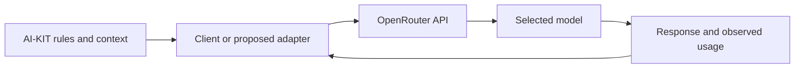

# Working with OpenRouter

**AI-KIT rules can travel with your API requests.** OpenRouter can provide model access while a client or adapter supplies selected AI-KIT instructions, project facts and task material. This makes the kit useful beyond native coding-client configuration.

**Integration status:** AI-KIT includes the explicit [bounded text executor](ORCHESTRATION.md). Instruction selection, dialogue exports, routing recommendations and opt-in measurements remain available. The general coding-agent/tool-loop architecture below is still a proposal; the shipped executor sends only explicitly selected text and never executes model output. Installing AI-KIT configures no API key or paid call.

## What can be reused

| AI-KIT component | Role in an OpenRouter workflow |
| --- | --- |
| [Core](../../template/ai-kit/CORE.md), engineering/security rules and the relevant stack profile | Trusted model instructions: language, authorization, implementation and review expectations |
| PROJECT_CONTEXT, project.json and decisions/ADRs | Verified project facts and constraints, supplied as reference data |
| [Context selector](../../scripts/context.py) | Select required rules/profiles by declared module; report file paths, byte counts, hashes and duplicates |
| [Router](../../template/ai-kit/router/POLICY.md) | Recommend a capability/model role; an adapter must resolve an available OpenRouter model and supported controls |
| [Metrics](../../template/ai-kit/METRICS.md) | Record agreed measurements from actual execution, including cached input tokens, cost, failures and recovery |
| Optional security-audit/Strix references | Include relevant guidance only on an explicit request; their execution prerequisites still apply |

OpenRouter cannot discover local AGENTS.md or follow filesystem links in a plain API request. A client must read the selected files and supply their contents. Repository text, logs and retrieved documents remain data; do not promote them into trusted instructions. Local tools and permission checks belong to the executing client. A model instruction alone does not enforce Git authorization or filesystem boundaries.

## Select context, then build the request

For an installed application with reviewed module facts, this existing command previews the instruction selection:

~~~sh
python aikit_cli.py context select /path/to/my-app --path api --budget 32000
~~~

Run it from the AI-KIT checkout; an installed package exposes the same command as `aikit context select`. It reports selected paths and hashes, not an assembled prompt or API response. The budget is bytes, not model tokens; critical rules and ADRs can exceed it. An adapter must account for the chosen model's context limit without silently dropping required constraints.

A useful request layout is:

| Position | Material | Update trigger |
| --- | --- | --- |
| First | Trusted Core, engineering/security rules and applicable profile | Policy/profile changes |
| Next | Reviewed project facts and decisions, clearly labeled as reference data | Project/context changes |
| Last | Current task, relevant code/diff and recent tool results | Each task or tool step |

Keep ordering and text serialization deterministic. Exclude unrelated profiles, duplicate references, secrets and obsolete logs. Read the actual current context before reuse; a cache is not a substitute for freshness checks.

OpenRouter accepts chat-completion messages at `POST https://openrouter.ai/api/v1/chat/completions`. The following is a schematic request body, not a shipped AI-KIT command. Replace placeholders with reviewed contents and a currently supported OpenRouter model ID; configure authentication separately. [API reference](https://openrouter.ai/docs/api/api-reference/chat/create-a-chat-completion).

~~~json
{
  "model": "<selected-openrouter-model-id>",
  "session_id": "<opaque-project-session-id>",
  "messages": [
    {"role": "system", "content": "<trusted AI-KIT policies and applicable profile>"},
    {"role": "user", "content": "Project reference data:\n<reviewed facts and decisions>"},
    {"role": "user", "content": "<current task and selected code or diff>"}
  ]
}
~~~

## Two different kinds of caching

**Prompt caching** reuses processing of repeated input. It suits successive tasks sharing policies and context. Keep the stable prefix first and changing task material later. Requests still carry messages; caching does not make local files accessible by name.

Availability, minimum eligible length, retention and write/read prices vary by model/provider. Some cache automatically; others need supported `cache_control` markers. Short prompts or changed prefixes can miss. `session_id` supports sticky routing, helping retain a provider; fallback or model changes can reduce reuse. Verify capabilities and observed hits rather than promising savings. [Prompt caching and sticky sessions](https://openrouter.ai/docs/guides/best-practices/prompt-caching).

For a verified model/provider supporting explicit text-block caching, a stable policy message can use this fragment. Include it in the request's messages; omit unsupported cache fields for other endpoints. This is an example for an adapter, not an installed cache configuration:

~~~json
{
  "role": "system",
  "content": [{
    "type": "text",
    "text": "<stable trusted policies>",
    "cache_control": {"type": "ephemeral"}
  }]
}
~~~

**Response caching** returns a stored answer for an identical request, including its model and parameters. OpenRouter exposes opt-in `X-OpenRouter-Cache` and TTL controls. It serves repeated identical operations; keep it disabled for independent reviews or experiments requiring a fresh generation. Distinguish a returned cached answer from a new model execution, and check retention-policy compatibility. [Response caching](https://openrouter.ai/docs/guides/features/response-caching).

## Measure actual behavior

Inspect `usage.prompt_tokens_details.cached_tokens`, `cache_write_tokens` when supplied, input/output/reasoning usage and `usage.cost`. OpenRouter reports these usage and billing fields; missing values remain unknown. A cache write may have a cost, so a warm-cache hit rate alone cannot establish savings. [Usage accounting](https://openrouter.ai/docs/cookbook/administration/usage-accounting).

The bounded text executor records observed cached tokens; a broader adapter could map observed cached tokens to AI-KIT's `cached_input_tokens`, record complete billed attempt cost and retain actual served model/provider identity. Include failed requests, retries, tool loops and review calls. Keep prompts, code, credentials and raw debug output out of measurement journals. The existing [benchmark protocol](../BENCHMARK.md#worker-protocol) can host a separately implemented worker; the text executor is not a benchmark-protocol worker. Compare equivalent tasks and reviewed correctness, and control cold/warm cache conditions explicitly.

## Further coding-agent adapter scope

Start with read-only analysis and code review: preview selected files and outgoing content, resolve model capabilities, enforce agreed request/time/spend limits, then capture response/usage. Add HTTP timeouts and bounded retries with complete accounting. An API key belongs in an approved external secret mechanism; confirm the destination and permitted source-data scope before sending code.

A later coding agent would also need a controlled tool loop for file changes and tests. Apply Core authorization before executing tools; a model response or tool-call request cannot grant commit/push permission. Choose provider and data-handling requirements explicitly, and disclose routing/fallback changes rather than hiding them behind the OpenRouter gateway label. Supported reasoning controls must be checked per model instead of copied blindly from another provider.

This section describes compatibility and a future adapter design. Installer defaults, provider selection and optional skill invocation remain governed by their existing contracts. A live connection, client activation, full audit or measured improvement requires its own execution evidence.
