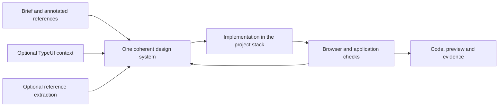

# Web Design


**Give your agent the sites you like, a short brief and the target project.** The optional Web Design module organizes that material into a coherent visual direction, reusable components and a working interface with recorded checks. It supports new websites and existing interfaces, with a detailed Laravel/Blade route and conditional guidance for Tailwind, Bootstrap, Alpine, Livewire, daisyUI, Flowbite and Flux.

AI-KIT supplies the workflow and project memory; the connected coding agent performs the work. TypeUI can supply a chosen design system, SkillUI can supply reference observations, and an available browser can verify the result. Those tools are separate, optional capabilities. Installing this module does not create an account, download npm/Composer packages, connect MCP, launch a browser, generate a site automatically or deploy it.

For current Codex and Claude Code connection commands, sign-in, project scope, verification and troubleshooting, follow [the TypeUI setup walkthrough](../../README.md#connect-typeui-to-codex-and-claude).

The installed [Web Design contract](../../template/ai-kit/WEB-DESIGN.md) is the canonical agent workflow. This guide explains how to use it, choose a route and understand the result. It has three parts: this page (installation, brief, design memory, context selection and visual direction), [implementation routes by stack](WEB_DESIGN_STACKS.md) and [tools, browser review, starter requests and troubleshooting](WEB_DESIGN_TOOLS.md).



## Install Web Design

Use a target application outside the AI-KIT checkout. Preview first:

```bash
python scripts/install.py /path/to/client-site --with-web-design --agent codex --agent claude
```

For a Windows target with spaces, the equivalent is:

```powershell
python scripts/install.py 'C:\Projects\Client Site' --with-web-design --agent codex --agent claude
```

Review the reported writes, preserved files, conflicts and warnings. When the requested installation is approved, repeat the same command with `--apply --check`. The installed `aikit` command accepts the same option:

```bash
aikit install /path/to/client-site --with-web-design --agent codex --agent claude --apply --check
```

Select only the clients you actually use. The module's four skills use normal relevant discovery; Codex receives source skills and selecting Claude also creates native copies. Other supported clients can follow the same canonical documents even when their skill discovery differs. File installation does not prove discovery in the running client: start/reload the client as needed and verify that the intended skill is available.

`--with-web-design` persists `web_design=true` in `ai-kit/settings.json`. It is independent of presets, security-audit, Strix and Context7. None of the presets enables it for a fresh project; an already enabled choice survives a later preset change. Add `--with-context7` separately if you want that documentation workflow, then connect its MCP server separately when needed.

## What the module installs

| Project path | Purpose | Update behavior |
| --- | --- | --- |
| `ai-kit/WEB-DESIGN.md` | Shared brief/reference/design/implementation workflow | Managed instruction; local adaptations are preserved or become reviewed conflicts |
| `ai-kit/web-design/LARAVEL.md` | Blade contracts, Tailwind/Bootstrap assets and Alpine/Livewire ownership | Conditional implementation reference |
| `ai-kit/web-design/LIBRARIES.md` | Selecting and using daisyUI, Flowbite or Flux | Read only for the selected library |
| `ai-kit/web-design/TOOLS.md` | TypeUI, external skills, browser analysis and SkillUI | Read only when that tool route applies |
| `ai-kit/web-design/REVIEW.md` | Responsive, interaction and accessibility acceptance | Evidence protocol for changed screens |
| `.agents/skills/web-design/` | Visual design from a brief/references or a requested redesign | Short skill with normal relevant discovery |
| `.agents/skills/laravel-blade-ui/` | Implementation in confirmed Blade interfaces | Does not force all Laravel frontends to Blade |
| `.agents/skills/ui-review/` | UI review and acceptance after changes | Uses available project/browser tools |
| `.agents/skills/design-extract/` | Requested reference analysis/extraction | Does not run an external CLI automatically |
| `docs/design/BRIEF.md` | Project audience, scope, content and annotated references | Created only when missing; existing bytes are preserved |
| `docs/design/SYSTEM.md` | Chosen visual rules, components, tokens and tool provenance | Project-owned memory, preserved by upgrades |
| `docs/design/ACCEPTANCE.md` | Required states, checks and actual evidence | Project-owned memory, preserved by upgrades |

Selecting Claude adds matching `.claude/skills/` copies. The source and native wrappers point to the same canonical rules. The installer does not bundle upstream TypeUI, Anthropic, Vercel or daisyUI skills; it supplies local, bounded guidance and primary-source links.

Fresh projects without the flag receive none of this module's skills, guides or design documents. Its registry/navigation entries are also omitted, so the default installation does not contain broken links to optional files. An existing project WIKI is preserved: during bootstrap, add pointers to the actual design documents rather than expecting the installer to rewrite your wiki.

## Give the agent a useful brief

You can start with a few paragraphs. Supply the information you know; unknowns need not block all work:

| Input | A useful description |
| --- | --- |
| Subject and audience | What the site offers, who uses it and what they need to understand |
| Main action | Contact the team, book a service, buy a product, read documentation or another concrete outcome |
| Structure | Required pages and sections, their purpose and approximate content |
| References | Links plus what you like about each: typography, composition, density, imagery or interaction |
| Materials | Logo, brand colors, text, photographs, icons and the rights/provenance of supplied assets |
| Behavior | Forms, search, account, CMS, payments, filters and other actual application requirements |
| Existing project | Its path, current pages/components and known Laravel/frontend versions |
| Language and constraints | User-facing language, device needs, accessibility, hosting or integration constraints |

A reference list is much more useful when annotated: the first site may contribute its readable typography, the second its section rhythm and the third its navigation behavior. The agent should reconcile those observations into one system rather than assemble unrelated fragments. If a reference cannot be accessed, it records that gap and works from available evidence or supplied images; it must not invent the page's contents.

AI-KIT keeps English authored project files and the configured chat language. State the required user-facing language explicitly when it differs, and preserve supplied user content. Do not place secrets, session cookies, private customer records or account credentials in a brief. Confidential raw material can remain in an agreed private location with sanitized pointers in the ordinary design documents.

## Start the workflow in your coding agent

After installation/bootstrap, invoke the main skill when useful:

```text
$web-design Build the website described in docs/design/BRIEF.md. Analyze the annotated references, reuse the project's confirmed stack, establish one design direction, implement the required pages and record actual acceptance evidence. Proceed within the requested local scope and resolve material unknowns as needed.
```

Claude Code uses `/web-design` instead of `$web-design`. Clients without this invocation form can be asked to read `ai-kit/WEB-DESIGN.md` and the project design documents directly. For an existing interface, narrow the request:

```text
$web-design Refine the pricing page using the existing design system. Improve hierarchy and mobile layout, preserve the current components and behavior, and check the changed page and form states.
```

The agent first inspects the actual project, reads existing design decisions and identifies material unknowns. It can propose a compact visual plan or a representative screen when the direction is new. A separate approval round is not imposed on every ordinary task; user preferences and the authorization needed for actual external actions determine where a pause is necessary.

## Keep design memory in the project

Use three documents with distinct responsibilities:

- **BRIEF:** audience, outcome, pages, real content, functional requirements and annotated references.
- **SYSTEM:** the chosen visual direction, token roles, responsive rules, component APIs and source/tool identity.
- **ACCEPTANCE:** the required routes/states and observed checks, including failures and unavailable runtime coverage.

If your project already has `docs/design-system.md`, a brand guide or a product specification, link those authoritative documents from the new files. Do not copy the same rules into every skill or create a second conflicting design system. For monorepos, record applicable paths/surfaces and link module-specific documents where needed.

The installer creates missing scaffolds with unknown fields; it does not infer that your site is Laravel, Tailwind or a particular visual style. Later installs preserve existing design document bytes, including files written before AI-KIT was installed. `--accept-local` applies to selected managed instructions, not these project-owned documents.

Private sharing mode hides kit/client configuration. Team mode shares the instructions. **The three design documents are ordinary project documentation visible in both modes.** Keep them suitable for the repository's audience. Working screenshots, reports and extraction data can stay in `ai-kit/.design/`, ignored in both modes; intended public website assets belong in the project's normal asset directories. Ignoring a path does not remove already tracked files.

## Select design context without loading every tool

The context helper can select the relevant workflow explicitly:

```bash
aikit context select /path/to/client-site --path web --workflow web-design --budget 32000
aikit context select /path/to/client-site --path web --workflow ui-review
aikit context select /path/to/client-site --path web --workflow design-extract
```

For a root project use `--path .`, or omit it. From the source checkout, prefix these commands with `python aikit_cli.py` instead of `aikit`.

Ordinary `context select` continues to select stack/Core/architecture context without adding the Web Design module. A design workflow requires `web_design=true`, adds the workflow entry and all three project documents, and retains them even when the requested byte budget is small. Confirmed Laravel/Filament module profiles also select Blade implementation guidance for the main design workflow; actual Blade usage still needs verification. Other languages and plain HTML do not receive assumed Laravel facts.

The helper returns paths, hashes and measured bytes, not an assembled model prompt or an API call. A plain HTML project may have no declared manifest-based module; the selected design workflow still works, while the report honestly leaves module coverage unestablished. Library/tool guides remain conditional reads selected by the agent from the actual task. No tokenizer or runtime-loaded-context savings is claimed.

## Turn a reference set into one visual direction

Ask the agent to identify the audience and the primary job of each page before choosing decoration. A useful plan covers:

- Information hierarchy and the order of sections, grounded in real content.
- A small semantic palette for brand, surface, text, border and functional states.
- Typeface choices, supported scripts, type scale and readable line lengths.
- Containers, grids, spacing rhythm and how composition changes on narrow screens.
- Reusable component states and one or more deliberate visual accents that serve the brief.
- Imagery, motion and reduced-motion behavior, with available assets and fallbacks.

These are decision criteria, not a compulsory look. Rounded cards, gradients, serif type and a restrained layout can all be appropriate when the brief calls for them. Avoid replacing one generic style with another universal ban. For an established product, consistency may matter more than novelty.

Anthropic's [frontend-design](https://github.com/anthropics/claude-code/blob/main/plugins/frontend-design/skills/frontend-design/SKILL.md) supports this method: ground choices in the subject, plan against the brief, build and critique. AI-KIT applies the useful principles through its own workflow. It does not install that external skill or let its aesthetic defaults override the user.

Next: [choose the implementation route](WEB_DESIGN_STACKS.md).
